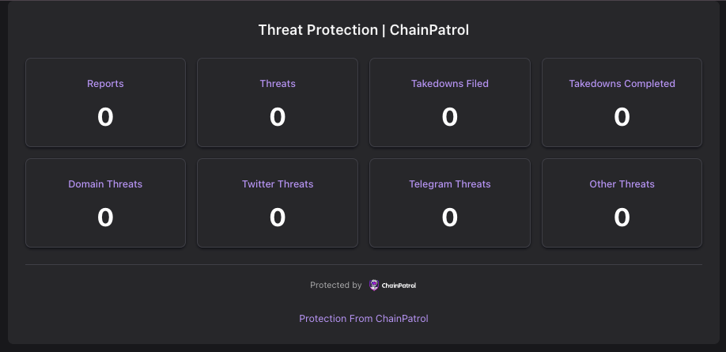
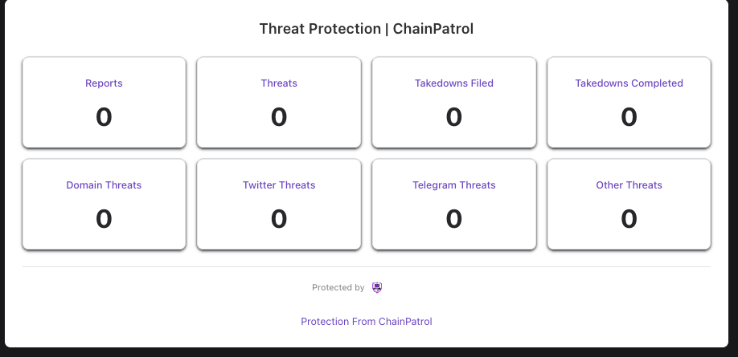
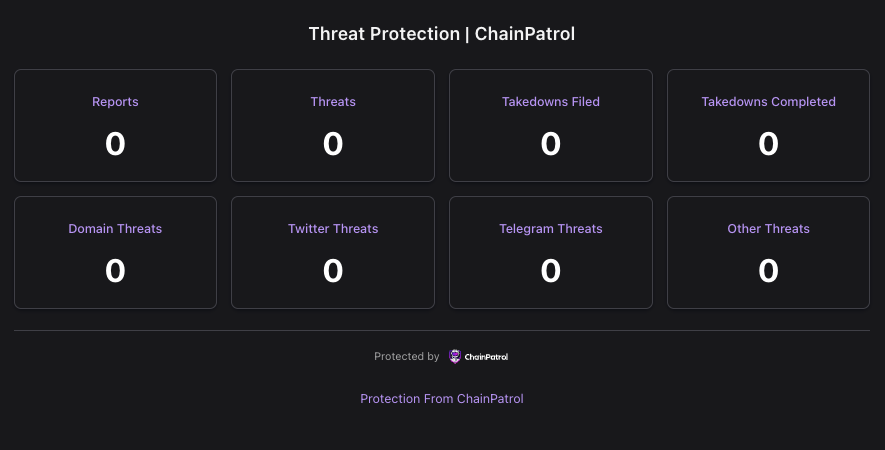

The ChainPatrol Embed Widget allows you to display your organization's threat protection metrics directly on your website. This widget provides real-time updates on your security metrics and can be customized to match your website's theme.

## Before you start

The widget only shows metrics for organizations that have made them public. An organization Owner or Admin can turn this on in **Settings → Security Portal** with the **Public Metrics** switch. The same switch also shows the metrics on your public security portal.

## Usage

To embed the widget on your website, use an iframe with the following URL structure:

```html
<iframe
  src="https://embed.chainpatrol.io/?slug=YOUR_ORGANIZATION_SLUG&theme=dark"
  width="1000"
  height="400"
  frameborder="0"
  style="border: none;"
></iframe>
```

## Parameters

The widget accepts the following URL parameters:

| Parameter | Description                           | Default  | Options                        |
| --------- | ------------------------------------- | -------- | ------------------------------ |
| `slug`    | Your organization's slug. Required | none | Any organization with Public Metrics turned on |
| `timeRange` | The period the metrics cover | `all` | `24h`, `7d`, `30d`, `90d`, `180d`, `365d`, `all` |
| `theme`   | The color theme of the widget         | `dark`   | `light`, `dark`, `transparent` |
| `width`   | The width of the widget               | `1000px` | Any valid CSS width value      |

<Note>
  Instead of metrics, the widget shows a short message when `slug` is missing, when no organization has that slug, or when the organization hasn't turned on Public Metrics.
</Note>

## Example URLs

- Default dark theme: `https://embed.chainpatrol.io/?slug=YOUR_ORGANIZATION_SLUG&theme=dark`
- Light theme: `https://embed.chainpatrol.io/?slug=YOUR_ORGANIZATION_SLUG&theme=light`
- Transparent background: `https://embed.chainpatrol.io/?slug=YOUR_ORGANIZATION_SLUG&theme=transparent`
- Custom width: `https://embed.chainpatrol.io/?slug=YOUR_ORGANIZATION_SLUG&theme=dark&width=800px`
- 30-day metrics: `https://embed.chainpatrol.io/?slug=YOUR_ORGANIZATION_SLUG&theme=dark&timeRange=30d`

## Metrics Displayed

The widget displays the following metrics:

- Reports
- Threats
- Takedowns Filed
- Takedowns Completed
- Domain Threats
- Twitter Threats
- Telegram Threats
- Other Threats

## Styling

The widget automatically adapts to your website's theme based on the `theme` parameter:

<CardGroup cols={3}>
  <Card title="Dark Theme" icon="square-1">
    <Frame></Frame>
  </Card>
  <Card title="Light Theme" icon="square-2">
    <Frame></Frame>
  </Card>
  <Card title="Transparent Theme" icon="square-3">
    <Frame></Frame>
  </Card>
</CardGroup>

- `light`: White background with dark text
- `dark`: Dark background with light text
- `transparent`: Transparent background that blends with your website

## Security

The embed widget is served over HTTPS and includes security headers to prevent clickjacking and other common web vulnerabilities. The widget only displays publicly available metrics and does not expose any sensitive information.
