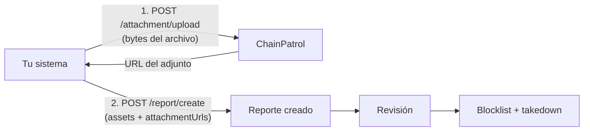

## Descripción general

Un reporte es la forma de avisarle a ChainPatrol sobre una amenaza. Cada reporte agrupa uno o
más **assets** (activos digitales: las URL, dominios, cuentas de redes sociales o direcciones
de blockchain sobre los que quieres que actuemos) con el **contexto** y la **evidencia** que
nuestro equipo de revisión necesita para actuar.

Todo pasa por [`POST /report/create`](/es/external-api/report-create). Los archivos de evidencia
son lo único que requiere una llamada aparte antes: los archivos se suben a
[`POST /attachment/upload`](/es/external-api/attachment-upload), que devuelve las URL que luego
pasas a `report.create`.



<Info>
  **Los adjuntos son opcionales.** Si no tienes archivos para enviar, omite por completo el
  paso 2 y llama a `report.create` directamente. Y si ya alojas tu evidencia en algún lugar de
  acceso público, pon esas URL directamente en `attachmentUrls`: el endpoint de subida existe
  para que no tengas que alojarlas tú.
</Info>

## Antes de empezar

Necesitas:

- **Una clave de API con permiso Read & write** (lectura y escritura), enviada como
  `X-API-KEY` en cada solicitud. Las claves nuevas son de solo lectura de forma
  predeterminada, y una clave de solo lectura recibe `403 Forbidden` aquí. Consulta
  [Autenticación de la External API](/es/external-api/authentication#permisos-de-la-clave).
- **El slug de tu organización**: el identificador que aparece en la URL de tu **Dashboard**
  (panel principal), es decir, `https://app.chainpatrol.io/<slug>`. Si tu clave está limitada
  a una sola organización, puedes omitir `organizationSlug` y usaremos la organización de la
  clave.

Todos los endpoints se sirven desde `https://app.chainpatrol.io/api/v2`.

## El flujo

<Steps>
  <Step title="Verifica si ya existe un reporte (opcional)">
    Si tu pipeline puede volver a descubrir la misma amenaza, verifica primero con
    [`POST /reports/search`](/es/external-api/reports-search). Volver a reportar un asset que
    ya tiene un reporte pendiente falla con un `422` y un error `REPORT_ALREADY_EXISTS`, así
    que buscar primero hace que tu tasa de errores siga siendo significativa.

    ```bash
    curl -X POST 'https://app.chainpatrol.io/api/v2/reports/search' \
      -H 'X-API-KEY: YOUR_API_KEY_HERE' \
      -H 'Content-Type: application/json' \
      -d '{"slug": "acme", "assetContents": ["https://acme-airdrop.example"]}'
    ```
  </Step>

  <Step title="Sube tus archivos de evidencia">
    Envía cada archivo a [`POST /attachment/upload`](/es/external-api/attachment-upload) y guarda
    las URL que devuelve. Se admiten archivos de mensajes `.eml`, capturas de pantalla, PDF y
    más; consulta los [tipos de archivo admitidos](/es/external-api/attachment-upload#tipos-de-archivo-admitidos).

    ```bash
    curl -X POST 'https://app.chainpatrol.io/api/v2/attachment/upload?fileName=phishing-email.eml' \
      -H 'X-API-KEY: YOUR_API_KEY_HERE' \
      --data-binary '@phishing-email.eml'
    ```

    ```json Response
    {
      "attachments": [
        {
          "url": "https://upcdn.io/ACCOUNT/raw/uploads/2026/09/03/api-attachments/org-42/8f14e45f-ea3a-4f0b-9b1a-1c2d3e4f5a6b/phishing-email.eml",
          "fileName": "phishing-email.eml",
          "sizeBytes": 48210
        }
      ]
    }
    ```

    Todavía no hay nada adjunto a un reporte: la subida solo almacena el archivo y te entrega
    una URL. Con multipart puedes enviar hasta 10 archivos en una sola solicitud; el límite de
    4 MB se aplica a todo el cuerpo de la solicitud.
  </Step>

  <Step title="Crea el reporte">
    Llama a [`POST /report/create`](/es/external-api/report-create) con tus assets y las URL de
    los adjuntos del paso anterior.

    ```bash
    curl -X POST 'https://app.chainpatrol.io/api/v2/report/create' \
      -H 'X-API-KEY: YOUR_API_KEY_HERE' \
      -H 'Content-Type: application/json' \
      -d '{
        "organizationSlug": "acme",
        "title": "Acme airdrop phishing email",
        "description": "Customer forwarded a phishing email impersonating Acme support. Raw message attached.",
        "contactInfo": "security@acme.example",
        "attachmentUrls": [
          "https://upcdn.io/ACCOUNT/raw/uploads/2026/09/03/api-attachments/org-42/8f14e45f-ea3a-4f0b-9b1a-1c2d3e4f5a6b/phishing-email.eml"
        ],
        "assets": [
          { "content": "https://acme-airdrop.example/claim", "status": "BLOCKED" },
          { "content": "@acme_support_help", "status": "BLOCKED" }
        ]
      }'
    ```

    ```json Response
    {
      "id": 1679208,
      "createdAt": "2026-09-03T23:21:46.450Z",
      "organization": {
        "id": 42,
        "slug": "acme",
        "name": "Acme"
      }
    }
    ```

    Guarda el `id`: es como se identifica el reporte en el dashboard y en
    [`GET /organization/reports`](/es/external-api/organization-reports-list).
  </Step>

  <Step title="Haz seguimiento de lo que pasa después">
    El reporte pasa a revisión. Las imágenes que adjuntaste aparecen integradas en el reporte;
    los demás archivos se listan como evidencia descargable, y nuestro equipo de **Takedowns**
    (solicitudes de baja de contenido fraudulento) puede reenviarlos al registrador o al
    proveedor de hosting; por eso un `.eml` original vale más que una captura de pantalla de
    ese mensaje.

    Consulta periódicamente [`GET /organization/reports`](/es/external-api/organization-reports-list)
    para ver el estado, o [configura un webhook](/es/external-api/webhook-config) para recibir una
    notificación cuando cambien los estados de los assets, en lugar de consultar periódicamente.
  </Step>
</Steps>

## Ejemplo completo

Sube y reporta en un solo script: dos archivos se suben en una única solicitud multipart, y
ambas URL se adjuntan a un mismo reporte.

<CodeGroup>

```typescript TypeScript
import { readFile } from "node:fs/promises";

const API_KEY = process.env.CHAINPATROL_API_KEY!;
const BASE_URL = "https://app.chainpatrol.io/api/v2";

async function uploadAttachments(paths: string[]): Promise<string[]> {
  const form = new FormData();

  for (const path of paths) {
    const bytes = await readFile(path);
    const fileName = path.split("/").pop()!;
    form.append("file", new File([bytes], fileName));
  }

  const response = await fetch(`${BASE_URL}/attachment/upload`, {
    method: "POST",
    headers: { "X-API-KEY": API_KEY },
    body: form,
  });

  if (!response.ok) {
    throw new Error(`Upload failed (${response.status}): ${await response.text()}`);
  }

  const { attachments } = await response.json();
  return attachments.map((attachment: { url: string }) => attachment.url);
}

async function createReport(attachmentUrls: string[]) {
  const response = await fetch(`${BASE_URL}/report/create`, {
    method: "POST",
    headers: {
      "Content-Type": "application/json",
      "X-API-KEY": API_KEY,
    },
    body: JSON.stringify({
      organizationSlug: "acme",
      title: "Acme airdrop phishing email",
      description: "Customer forwarded a phishing email impersonating Acme support.",
      contactInfo: "security@acme.example",
      attachmentUrls,
      assets: [{ content: "https://acme-airdrop.example/claim", status: "BLOCKED" }],
    }),
  });

  if (!response.ok) {
    // 422 responses carry per-asset details in data.errors
    throw new Error(`Report failed (${response.status}): ${await response.text()}`);
  }

  return response.json();
}

const urls = await uploadAttachments([
  "./phishing-email.eml",
  "./screenshot.png",
]);
const report = await createReport(urls);
console.log(`Created report ${report.id}`);
```

```python Python
import os
import requests

API_KEY = os.environ["CHAINPATROL_API_KEY"]
BASE_URL = "https://app.chainpatrol.io/api/v2"
HEADERS = {"X-API-KEY": API_KEY}


def upload_attachments(paths):
    files = [("file", (path.split("/")[-1], open(path, "rb"))) for path in paths]

    response = requests.post(
        f"{BASE_URL}/attachment/upload", headers=HEADERS, files=files
    )
    response.raise_for_status()

    return [attachment["url"] for attachment in response.json()["attachments"]]


def create_report(attachment_urls):
    response = requests.post(
        f"{BASE_URL}/report/create",
        headers=HEADERS,
        json={
            "organizationSlug": "acme",
            "title": "Acme airdrop phishing email",
            "description": "Customer forwarded a phishing email impersonating Acme support.",
            "contactInfo": "security@acme.example",
            "attachmentUrls": attachment_urls,
            "assets": [
                {"content": "https://acme-airdrop.example/claim", "status": "BLOCKED"}
            ],
        },
    )
    response.raise_for_status()

    return response.json()


urls = upload_attachments(["./phishing-email.eml", "./screenshot.png"])
report = create_report(urls)
print(f"Created report {report['id']}")
```

```bash cURL
# 1. upload both files in one multipart request
curl -X POST 'https://app.chainpatrol.io/api/v2/attachment/upload' \
  -H "X-API-KEY: $CHAINPATROL_API_KEY" \
  -F 'file=@phishing-email.eml' \
  -F 'file=@screenshot.png'

# 2. attach the returned URLs to a report
curl -X POST 'https://app.chainpatrol.io/api/v2/report/create' \
  -H "X-API-KEY: $CHAINPATROL_API_KEY" \
  -H 'Content-Type: application/json' \
  -d '{
    "organizationSlug": "acme",
    "title": "Acme airdrop phishing email",
    "description": "Customer forwarded a phishing email impersonating Acme support.",
    "attachmentUrls": [
      "https://upcdn.io/ACCOUNT/raw/uploads/.../phishing-email.eml",
      "https://upcdn.io/ACCOUNT/raw/uploads/.../screenshot.png"
    ],
    "assets": [
      { "content": "https://acme-airdrop.example/claim", "status": "BLOCKED" }
    ]
  }'
```

</CodeGroup>

## Campos del reporte

Los campos que más vas a usar. El esquema completo, con todos los campos opcionales, está en la
página de referencia [Crear reporte](/es/external-api/report-create).

| Campo                    | Tipo   | Obligatorio | Descripción                                                                                                                              |
| ------------------------ | ------ | ----------- | ---------------------------------------------------------------------------------------------------------------------------------------- |
| `assets`                 | array  | Sí          | Los assets que se reportan. Al menos uno.                                                                                                |
| `assets[].content`       | string | Sí          | La URL, el dominio, la cuenta de red social o la dirección de blockchain. Los números de teléfono necesitan un código de país en formato E.164 (`+14155552671`). |
| `assets[].status`        | string | No          | Estado que propones: `BLOCKED` (predeterminado), `ALLOWED` o `UNKNOWN`.                                                                  |
| `assets[].brandSlug`     | string | No          | A cuál de tus marcas suplanta el asset. Los revisores pueden cambiarlo.                                                                  |
| `organizationSlug`       | string | No          | Organización en la que se registra el reporte. De forma predeterminada es la organización de tu clave de API cuando la clave está limitada a una sola. |
| `title`                  | string | No          | Resumen breve. Mínimo 3 caracteres.                                                                                                      |
| `description`            | string | No          | Los detalles con los que trabajan los revisores. Admite Markdown.                                                                        |
| `contactInfo`            | string | No          | Cómo contactar a quien reporta, si necesitamos hacer seguimiento.                                                                        |
| `attachmentUrls`         | array  | No          | URL de archivos de evidencia: de [Subir archivo adjunto](/es/external-api/attachment-upload) o tus propios enlaces de acceso público.               |
| `externalSubmissionLink` | string | No          | Enlace al lugar de donde salió el reporte, como un mensaje de Telegram o un ticket de soporte.                                           |

<Note>
  `organizationSlug`, `discordGuildId` y `telegramGroupId` son tres formas de nombrar lo
  mismo. Usa `organizationSlug` salvo que estés creando una integración con Discord o Telegram
  y solo tengas a mano el ID de la plataforma.
</Note>

## Los adjuntos en más detalle

- **Cualquier tipo de archivo de la lista admitida, no solo imágenes.** El endpoint de subida
  acepta mensajes `.eml` y `.msg`, PDF, documentos de Word, CSV, texto plano y los formatos de
  imagen más comunes.
- **Las imágenes se muestran; los demás archivos se listan.** Clasificamos por extensión: las
  extensiones de imagen se muestran integradas en el reporte y todo lo demás aparece como
  archivo descargable.
- **Los archivos que no son imágenes pueden enviarse con el takedown.** Nuestro equipo puede
  adjuntarlos al correo que se envía a un registrador o proveedor de hosting, con el nombre de
  archivo que subiste; por eso, usa nombres de archivo descriptivos.
- **Las URL alojadas por ti también funcionan.** Todo lo que esté en `attachmentUrls` se
  guarda tal cual. Si alojas la evidencia por tu cuenta, mantén esos enlaces activos; no
  podemos volver a descargar un enlace que ya expiró.
- **Adjunta los archivos al reporte del que son evidencia.** Los adjuntos pertenecen al
  reporte en su conjunto, no a un asset individual; por eso, si dos amenazas no están
  relacionadas, crea dos reportes.

## Manejo de errores

`report.create` devuelve `422 Unprocessable Content` cuando la solicitud está bien formada pero
los assets no se pueden reportar; es el resultado más común que debes contemplar en tu código.
La respuesta incluye una entrada por cada asset con error en `data.errors`, cada una con un
`errorType`, un `message` y una `suggestion`:

```json
{
  "message": "Report creation failed: 1 of 2 assets already has a pending report. You can find and escalate existing reports in your ChainPatrol dashboard.",
  "code": "UNPROCESSABLE_CONTENT",
  "data": {
    "errors": [
      {
        "asset": "https://acme-airdrop.example/claim",
        "errorType": "REPORT_ALREADY_EXISTS",
        "message": "A report for this asset is already being processed",
        "suggestion": "Find the existing report in your ChainPatrol dashboard under Reports and escalate it there if needed"
      }
    ]
  }
}
```

Todos los assets deben ser válidos para que se cree el reporte: un `422` significa que no se
creó ningún reporte. Corrige o quita los assets con problemas y vuelve a enviar. Todos los
`errorType` están listados en la página de referencia
[Crear reporte](/es/external-api/report-create).

Para los errores de subida, consulta las
[respuestas de error](/es/external-api/attachment-upload#respuestas-de-error) en la página Subir
archivo adjunto.

## Buenas prácticas

- **Un reporte por amenaza, varios assets por reporte.** Si una campaña de phishing abarca un
  sitio, una cuenta de Twitter y una dirección de wallet, pon los tres en un mismo reporte: el
  contexto compartido es lo que permite revisarlos juntos.
- **Busca antes de enviar** si tu pipeline puede volver a descubrir el mismo asset.
- **Envía el `.eml` original cuando lo tengas.** Los encabezados son lo que los proveedores de
  correo y los registradores usan para actuar; una captura de pantalla de un correo es una
  evidencia mucho más débil.
- **Incluye una descripción con la que una persona pueda actuar.** Cuál fue el señuelo, dónde
  se vio, quién lo reportó.
- **Define `brandSlug`** cuando sepas qué marca se está suplantando: ahorra un paso de
  revisión. Obtén los slugs válidos desde
  [Listar marcas de la organización](/es/external-api/organization-brands).
- **No reintentes un `422` sin cambios.** Es un resultado de validación, no una falla
  transitoria. Reintenta los `5xx` con backoff exponencial.

## Otras formas de crear reportes

<CardGroup cols={2}>
  <Card title="CLI" icon="terminal" href="/es/cli/commands/reports">
    `chainpatrol reports create` crea un reporte desde la terminal, incluido
    `--attachment-url` para la evidencia que ya subiste.
  </Card>

  <Card title="Dashboard" icon="browser" href="https://app.chainpatrol.io">
    Tu equipo puede crear reportes manualmente y arrastrar archivos de evidencia directamente
    sobre ellos.
  </Card>

  <Card title="Security Portal" icon="shield" href="/es/concepts/security-portal">
    Un formulario público de envío para tu comunidad, sin necesidad de iniciar sesión.
  </Card>

  <Card title="Bots" icon="robot" href="/es/integration/discord">
    Los bots de Discord, Telegram y Slack permiten que tu comunidad reporte desde donde ya
    está.
  </Card>
</CardGroup>

<Note>
  La CLI y el SDK de JavaScript reciben **URL** de adjuntos, no archivos. Para subir un archivo
  hoy, llama directamente a [`POST /attachment/upload`](/es/external-api/attachment-upload) y pasa
  la URL que devuelve.
</Note>
