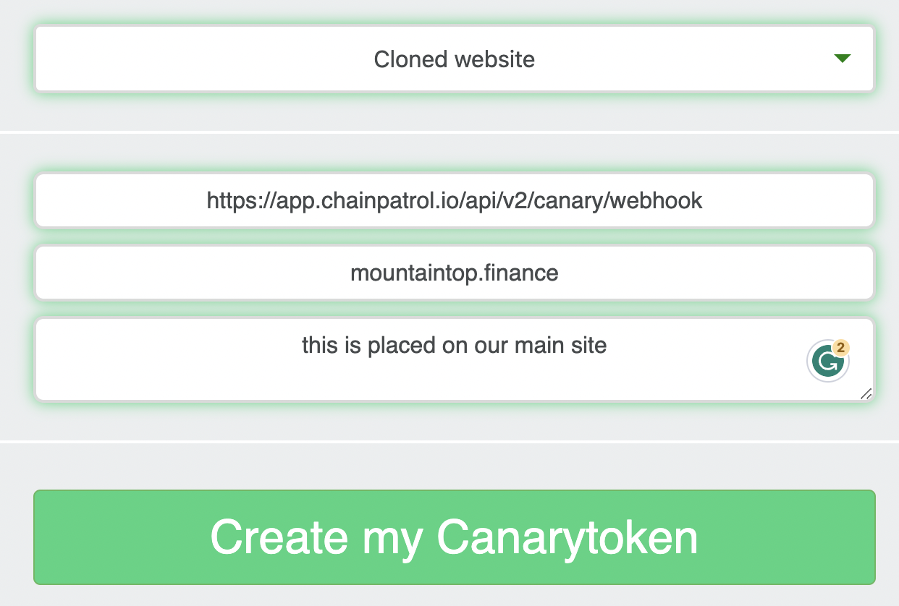
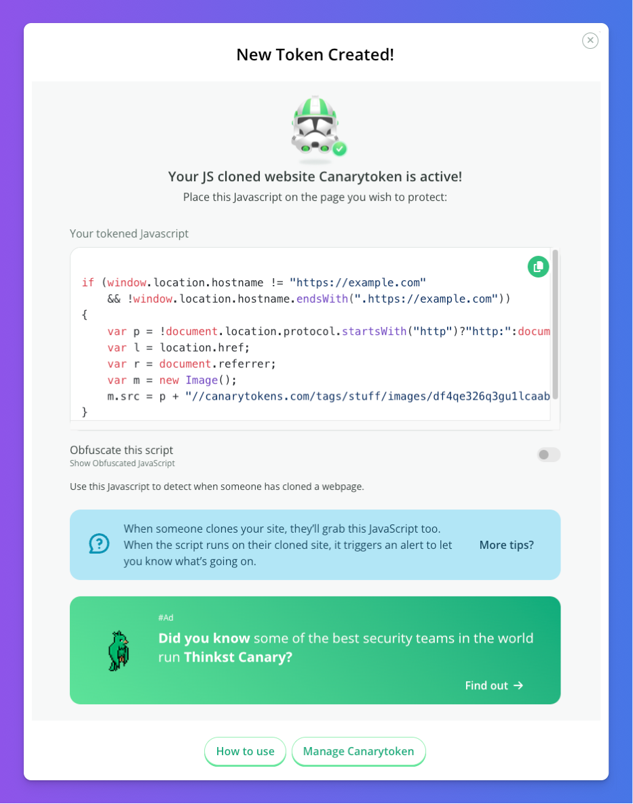
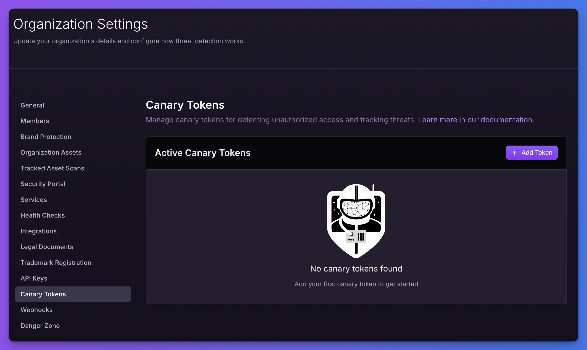
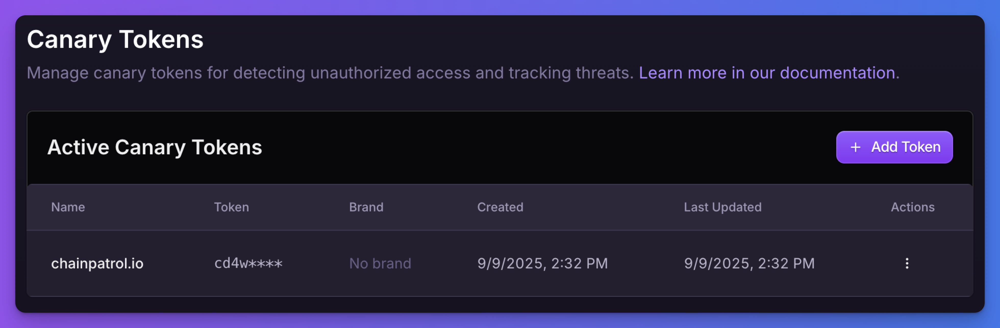
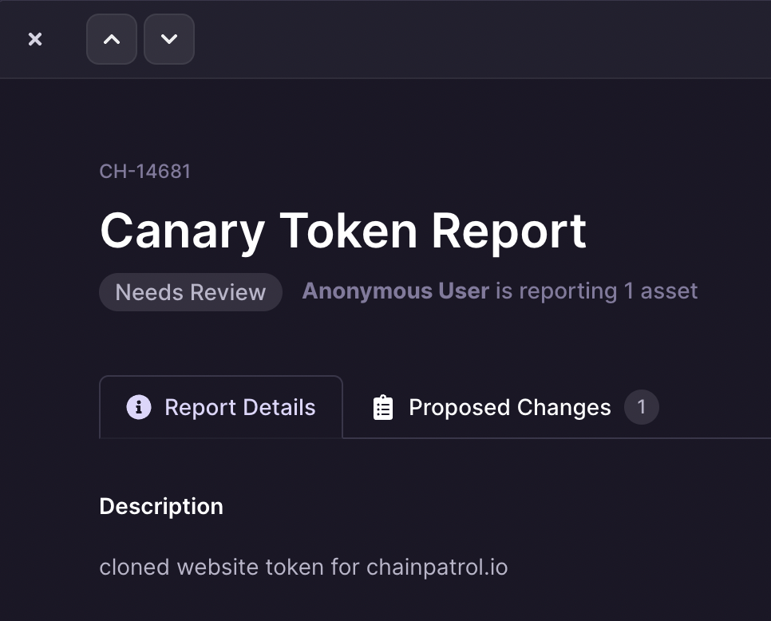

## ¿Qué es un Canary Token?

Los Canary Tokens son una herramienta gratuita y de código abierto que te ayuda a descubrir cuándo actores maliciosos acceden a tus datos. Se pueden usar para detectar accesos no autorizados a tu sitio web, tus documentos u otra información sensible.

Puedes leer más en el [sitio web de Canary Tokens](https://docs.canarytokens.org/guide/).

## Cloned Website Tokens

Los Cloned Website Tokens (tokens de sitio web clonado) son un tipo de Canary Token que se puede usar para detectar cuándo clonan tu sitio web. Funcionan incrustando en tu sitio web un token único que es invisible para tus usuarios. Cuando un actor malicioso clona tu sitio web, también clona el token. Cuando se accede al token, recibirás una notificación y ChainPatrol procederá a bloquear el sitio clonado malicioso y a iniciar su **Takedown** (solicitud de baja de contenido fraudulento).

Puedes leer más sobre los Cloned Website Tokens en el [sitio web de Canary Tokens](https://docs.canarytokens.org/guide/cloned-web-token.html).

## Instrucciones de configuración

<Steps>
  <Step title="Crea un nuevo Canary Token">
    Ve a [Canary Tokens Nest](https://canarytokens.org/nest/) y selecciona `JS cloned website` en la lista.

    Completa los campos con la siguiente información:

    | Campo | Valor |
    | :---- |:----- |
    | Domain of protected website (dominio del sitio web protegido) | `<YOUR DOMAIN>` |
    | Mail me here when the alert fires (correo al que se enviará la alerta) | `<YOUR EMAIL>` |
    | Remind me of this when the alert fires (recordatorio que verás cuando se dispare la alerta) | La nota que quieras (p. ej., `Token for <YOUR DOMAIN>`) |

    A continuación, haz clic en **Add Webhook Notification** y completa la siguiente información:

    | Campo | Valor |
    | :---- |:----- |
    | Notify me here when the alert fires (URL a la que se notificará la alerta) | `https://app.chainpatrol.io/api/v2/canary/webhook` |

    Cuando termines, debería verse más o menos así:

    

    Haz clic en **Create Canarytoken**.

  </Step>
  <Step title="Ve a la administración del token">
    Después de crear el token, verás la ventana modal con la información del token.

    

    Haz clic en **Manage Canarytoken** para ir a la página del token.

    > **Nota:** Te conviene guardar la URL de esta página para consultarla más adelante.
  </Step>
  <Step title="Agrega el token a ChainPatrol">    

    Después de hacer clic en el botón, se te redirigirá a la página del token. Es una URL generada de forma única que contiene el token y a la que puedes volver para ver el historial de tu Canary Token.

    Ejemplo: `https://canarytokens.org/nest/manage/<NEST_ID>/<TOKEN_ID>`

    A continuación, ve a tu **Dashboard** (panel principal) de ChainPatrol y entra en **Settings** (configuración) > **Canary Tokens**.
    
    

    Para que ChainPatrol detecte automáticamente los sitios web clonados, **crea un nuevo token y pega el ID del token que aparece en la página de tu token**.

    Después de crear el token, lo verás en la lista. Puedes eliminar o editar el token en cualquier momento.

    A partir de este momento, nuestro webhook empezará a recibir alertas cuando se acceda al token.

    
  </Step>
  <Step title="Agrega el fragmento de JavaScript generado a tu sitio web">
    Por último, para completar la configuración del Canary Token, debes agregar el fragmento de JavaScript generado al dominio que indicaste antes.
    
    1. Activa la opción **"Obfuscate this script"** y copia el código generado.
    2. Pega el código en el HTML de tu sitio web, preferiblemente en la etiqueta `<head>` de la página de inicio.
    
    > **Nota:** Recomendamos desactivar **Email Alerts**, ya que pueden incluir URL de localhost y otros falsos positivos. Nosotros gestionaremos las alertas mediante el webhook.
  </Step>
</Steps>

## ¿Qué pasa cuando se detecta un sitio web clonado?

Cuando clonen tu sitio web, crearemos un nuevo reporte en tu dashboard de ChainPatrol.
ChainPatrol procederá a bloquear el sitio clonado malicioso y a iniciar su takedown.

