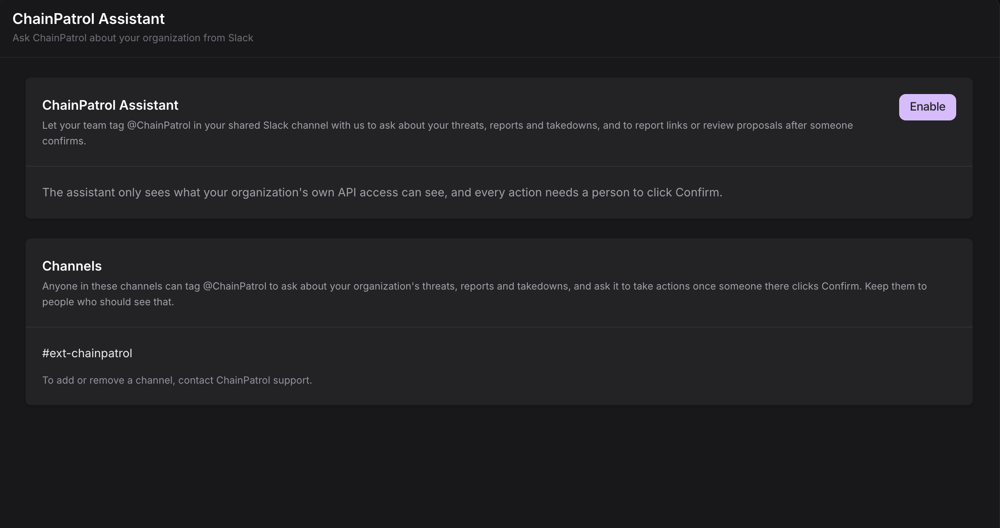
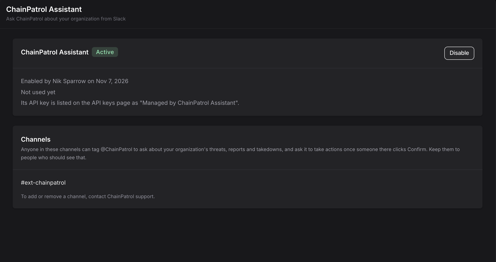

El ChainPatrol Assistant responde preguntas sobre tu organización directamente en Slack. Etiqueta a `@ChainPatrol` en tu canal de Slack compartido con ChainPatrol y pregunta cosas como "¿qué dimos de baja esta semana?" o "¿este enlace está bloqueado?". También puede reportar enlaces, revisar **Proposals** (propuestas para bloquear o permitir un asset) y presentar disputas, pero solo después de que alguien en el canal haga clic en **Confirm**.

<Info>
  El ChainPatrol Assistant está disponible para clientes seleccionados. Para obtener acceso,
  contacta a tu representante de ChainPatrol o escribe a
  [support@chainpatrol.io](mailto:support@chainpatrol.io).
</Info>

## Antes de empezar

- Tu espacio de trabajo de Slack está conectado a ChainPatrol. Consulta la [integración de Slack](/es/integration/slack).
- Tienes un canal de Slack compartido (Slack Connect) con ChainPatrol. Ahí es donde responde el asistente.
- Eres **Owner** o **Admin** de tu organización de ChainPatrol. Los demás miembros pueden ver la página de configuración, pero no pueden activar ni desactivar el asistente.

## Actívalo

<Steps>
  <Step title="Abre la configuración del ChainPatrol Assistant">
    En la [app de ChainPatrol](https://app.chainpatrol.io/), ve a **Settings** (configuración) y selecciona **ChainPatrol Assistant** en la barra lateral.

    <Frame></Frame>

  </Step>
  <Step title="Haz clic en Enable">
    Haz clic en **Enable**. El estado cambia a **Active**, y la página muestra quién lo activó y cuándo.

    <Frame></Frame>

  </Step>
  <Step title="Pídele a ChainPatrol que agregue tu canal">
    El asistente solo responde en los canales que ChainPatrol agregó para tu organización. Contacta al soporte de ChainPatrol para agregar tu canal compartido. Una vez agregado, aparece en **Channels** en la misma página.

    Cuando se agrega un canal, el asistente publica y fija allí un breve mensaje de bienvenida, para que todas las personas del canal sepan que está disponible.

  </Step>
</Steps>

Cuando activas el asistente, ChainPatrol crea una clave de API solo para él. Esa clave puede ver y hacer únicamente lo que puede el acceso por API de tu propia organización. Aparece en tu página **API keys** (claves de API) como "Managed by ChainPatrol Assistant" (administrada por ChainPatrol Assistant). Nadie, ni siquiera tú, ve nunca la clave en sí.

<Warning>
  Cualquier persona en un canal de la lista puede preguntarle al asistente sobre tu organización y
  hacer clic en Confirm en sus acciones. Limita estos canales a las personas que deberían ver
  tus datos de ChainPatrol.
</Warning>

## Haz una pregunta

Etiqueta a `@ChainPatrol` con tu pregunta. El asistente primero responde "Looking into it…" (lo estoy revisando…) en un hilo, y luego reemplaza ese mensaje con su respuesta.

- **Preguntas de seguimiento:** responde en el mismo hilo y etiqueta a `@ChainPatrol` otra vez. Lee los mensajes anteriores del hilo, incluidas sus propias respuestas, así que no necesitas repetir nada.
- **Capturas de pantalla:** puedes adjuntar una captura de pantalla de un sitio o mensaje sospechoso. El asistente lee los enlaces, cuentas, direcciones de wallet y otros detalles que aparecen en las cuatro imágenes más recientes del hilo.
- **Enlaces a reportes:** pega un enlace a un reporte de ChainPatrol y te dice, para cada **asset** (activo digital: URL, dirección, perfil, app, etc.), cómo se revisó, si está bloqueado, si sigue online y cómo va su **takedown** (solicitud de baja de contenido fraudulento).

El asistente lee solo el hilo en el que lo etiquetaste. No lee el resto del canal ni ninguna otra cosa de tu espacio de trabajo de Slack.

### Sobre qué puedes preguntar

<CardGroup cols={2}>
  <Card title="Assets" icon="magnifying-glass">
    Si un enlace, cuenta o dirección está bloqueado, permitido o fue reportado.
  </Card>
  <Card title="Reportes y amenazas" icon="flag">
    Tus reportes, amenazas, **Watchlist** (lista de seguimiento) y Proposals que esperan tu revisión.
  </Card>
  <Card title="Takedowns" icon="gavel">
    Takedowns en curso y completados, y cuánto tiempo tomaron.
  </Card>
  <Card title="Métricas" icon="chart-line">
    Amenazas encontradas, dónde se encontraron, tasa de éxito de los takedowns y tiempo hasta el takedown.
  </Card>
  <Card title="Tu configuración" icon="gear">
    Tus marcas, **Allowlist** (lista de permitidos), grupos de assets y configuración de detección.
  </Card>
  <Card title="Cómo funciona ChainPatrol" icon="book">
    Preguntas sobre el **Dashboard** (panel principal), las integraciones y la API, respondidas a partir de esta documentación, con un enlace a la página que usó.
  </Card>
</CardGroup>

Responde solo a partir de los datos de ChainPatrol de tu organización y de esta documentación. No inventa cifras y no puede responder preguntas sobre otras organizaciones.

## Acciones y Confirm

El asistente puede realizar tres acciones:

| Acción | Qué hace |
| --- | --- |
| **Reportar** | Reporta hasta 10 enlaces, cuentas o direcciones a ChainPatrol. No reportará un sitio conocido completo, como una red social importante. |
| **Revisar una Proposal** | Aprueba (bloquea), rechaza, o rechaza y agrega a la watchlist una Proposal que espera tu revisión. Una revisión no se puede deshacer. |
| **Disputar** | Disputa una decisión de ChainPatrol sobre un enlace, cuenta o dirección. Las respuestas a la disputa le llegan al administrador que activó el asistente. |

Pídelo con palabras sencillas, por ejemplo "@ChainPatrol por favor reporta este enlace". El asistente nunca actúa por su cuenta. Publica en el hilo una tarjeta que muestra exactamente lo que se enviará, con los botones **Confirm** y **Cancel**.

- No ocurre nada hasta que alguien en el canal hace clic en **Confirm**.
- La tarjeta vence después de **15 minutos**. Después de eso, vuelve a pedirlo.
- Solo cuenta un clic. Una vez que alguien confirma o cancela, la tarjeta muestra quién lo hizo y qué ocurrió.

Los reportes, revisiones y disputas enviados de esta forma incluyen la nota "Sent through the ChainPatrol Assistant in Slack" (enviado a través del ChainPatrol Assistant en Slack) con los nombres en Slack de la persona que lo pidió y de la persona que confirmó.

## Habla con una persona

Pídele al asistente hablar con alguien, o dile que algo es urgente. El asistente le pasa tu mensaje al equipo de ChainPatrol, y un miembro del equipo responde en el mismo hilo de Slack. Si quieres una llamada, comparte un enlace para agendar una con nuestro equipo de éxito del cliente (customer success).

## Límites

- **Dónde funciona:** solo en los canales que ChainPatrol agregó para tu organización. No responde en mensajes directos. En cualquier otro canal, solo tú ves una respuesta que indica que no está activado allí.
- **Con qué frecuencia:** cada persona puede hacer hasta 10 preguntas seguidas y, después, aproximadamente una más por minuto. Pasado ese límite, el asistente te pide que esperes un poco y vuelvas a intentarlo.
- **Revisiones de Proposals:** sumadas a las revisiones hechas a través de la API, hasta 10 revisiones de Proposals por organización por día. Las revisiones hechas en la página **Review** (revisión de propuestas pendientes de aprobación) del dashboard no cuentan para este límite.
- **Hablar con una persona:** hasta 10 solicitudes por organización por hora.

## Desactívalo

Ve a **Settings → ChainPatrol Assistant** y haz clic en **Disable**, luego confirma. El asistente deja de responder de inmediato, y su clave de API se revoca. Puedes volver a activarlo más adelante, y recibe una clave nueva.

Si la página muestra **Needs attention**, la clave de API del asistente fue revocada (por ejemplo, desde la página API keys). Haz clic en **Re-enable** para darle una clave nueva. Si muestra **Paused**, ChainPatrol pausó el asistente para tu organización. Contacta al soporte si tienes alguna pregunta.

## Privacidad

- El asistente solo ve lo que puede ver el acceso por API de tu propia organización. No puede consultar otras organizaciones.
- Las respuestas las escribe un modelo de IA. ChainPatrol le envía el hilo en el que lo etiquetaste y los datos que consulta para tu pregunta. Consulta [Cómo usamos la IA](/es/getting-started/how-it-works/how-we-use-ai).
- Tus conversaciones con el asistente no se usan para entrenar modelos de IA, ni los de ChainPatrol ni los del proveedor de IA. ChainPatrol no almacena la conversación en sí; solo conserva el registro de las acciones confirmadas que se describe a continuación.
- Por cada acción que alguien confirma, ChainPatrol conserva un registro de lo que se envió, el resultado, el canal y el hilo, y los nombres e ID de Slack de la persona que lo pidió y de la persona que confirmó. Las tarjetas canceladas y vencidas no se registran.
- Los enlaces en sus respuestas se escriben en un formato seguro (por ejemplo `hxxps[://]example[.]com`), para que nadie abra un sitio de phishing por accidente.
