<Frame>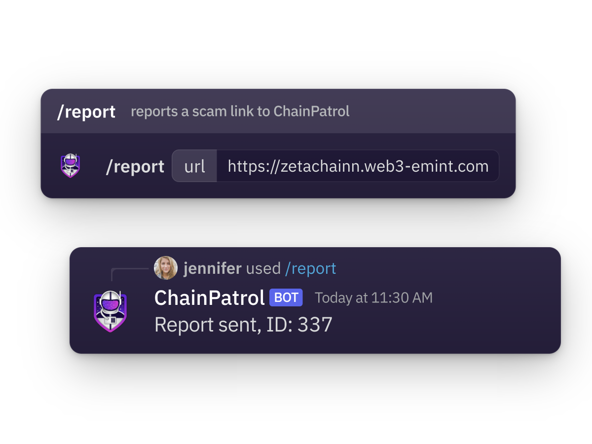</Frame>

Si tienes un **servidor de Discord**, puedes usar el [bot de Discord de ChainPatrol](https://chainpatrol.com/bot)
para que los miembros de tu servidor envíen reportes de estafas a **ChainPatrol**. El bot generará nuevos
reportes que se envían a tu **Dashboard** (panel principal) de administración para su revisión.

## Configuración

<Tip>
  Si tienes un canal dedicado `scam-reports`, te recomendamos fijar un mensaje
  en ese canal e indicar a los miembros de tu servidor que usen el bot allí para
  reportar fácilmente
</Tip>

### Instalar el bot

Para agregar el bot a tu servidor, necesitas ser administrador del servidor. Luego,
puedes usar el siguiente enlace para agregar el bot:

[🚀 Agrega ChainPatrol a tu servidor](https://chainpatrol.com/bot/install)

A continuación, conecta tu servidor de Discord con tu organización de ChainPatrol para que los reportes lleguen a tu dashboard. Necesitas ser **Owner** o **Admin** de la organización.

1. En el [dashboard de ChainPatrol](https://app.chainpatrol.io/admin), ve a **Settings → Integrations → Discord** (configuración → integraciones → Discord) y haz clic en **Add to Discord**.
2. Discord te pide que elijas tu servidor y apruebes el bot.
3. Discord te envía de vuelta a la página **Connect Discord** de ChainPatrol. Elige tu organización y haz clic en **Connect**.

Cada organización puede conectarse a un solo servidor de Discord, y cada servidor a una sola organización.

Para comprobar que el bot funciona, puedes usar el comando `/setup status` para ver si el bot está
conectado a tu organización de ChainPatrol.

## Funciones

### Reportes de estafas

El bot permite que los miembros del servidor envíen reportes de estafas directamente a ChainPatrol.

#### Uso

Una vez que el bot esté agregado a tu servidor, puedes usar los siguientes comandos:

- `/report <url>` - Envía un reporte de estafa para la URL indicada
- `/check <url>` - Comprueba si la URL indicada es una estafa

#### Ejemplo

Este es un ejemplo de cómo usar el bot para enviar un reporte de estafa:

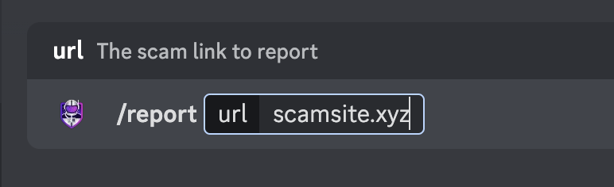
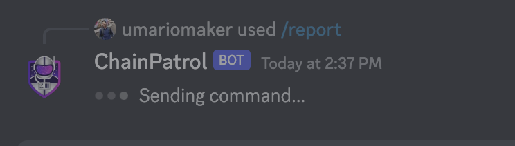
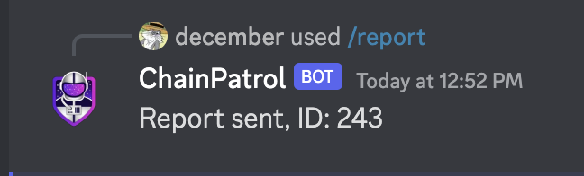

### Feed de reportes

Puedes crear un canal de feed con todos los reportes enviados a tu organización. Esta función te permite ver en un canal dedicado todos los reportes de estafas enviados a través del bot.

#### Configuración

1. Crea un canal nuevo en tu servidor de Discord y ponle un nombre como `chainpatrol-reports`
2. Usa el siguiente comando para vincular el canal con tu organización de ChainPatrol:
   ```
   /setup feed <channel>
   ```
3. Sigue las instrucciones de la respuesta del bot para vincular el canal con tu organización de ChainPatrol

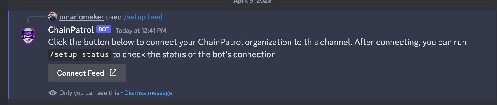

Puedes comprobar que el feed está conectado correctamente ejecutando el comando `/setup status`. Si el
feed está conectado correctamente, deberías ver el nombre del canal en la respuesta del bot.

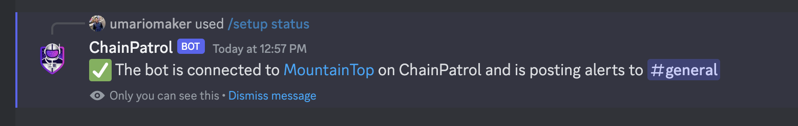

Como prueba final, puedes intentar enviar un reporte de estafa de prueba con el comando `/report`. Deberías ver un mensaje
en el canal de feed con el reporte de estafa poco después de enviarlo.

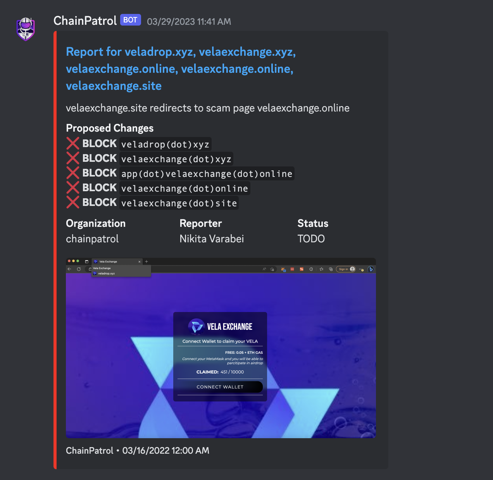

### Monitoreo de enlaces

ChainPatrol puede monitorear tus canales de Discord en busca de enlaces sospechosos y tomar medidas automáticamente cuando los detecta. Esta función ayuda a proteger a tu comunidad de estafas y contenido malicioso.

#### Configuración

Para habilitar el monitoreo de enlaces en un canal:

1. Ve al canal que quieres monitorear
2. Ejecuta el comando `/setup linkmonitoring`
3. Confirma la configuración cuando se te pida

<Tip>
  Solo los administradores del servidor o los usuarios con el permiso "Manage Server"
  (gestionar servidor) pueden habilitar el monitoreo de enlaces
</Tip>

#### Cómo funciona

Una vez habilitado, ChainPatrol hará lo siguiente:

1. Monitorear todos los mensajes del canal configurado en busca de URLs
2. Comprobar cada URL contra la amplia **Blocklist** (lista de bloqueo) de ChainPatrol, que incluye:
   - Sitios web de estafas conocidos
   - Intentos de phishing
   - Dominios maliciosos
   - Otras amenazas de seguridad reportadas a ChainPatrol
3. Tomar medidas según la configuración de tu servidor cuando se detecten enlaces sospechosos

<Tip>
  La blocklist se actualiza continuamente con nuevas amenazas reportadas por la
  comunidad de ChainPatrol y por investigadores de seguridad. Puedes [buscar en nuestra
  blocklist](https://app.chainpatrol.io/search) para ver de qué amenazas te estamos
  protegiendo.
</Tip>

#### Acciones de respuesta

Cuando se detecta un enlace sospechoso, ChainPatrol se puede configurar para:

- **Reaccionar con 🚨** - Agrega una reacción de advertencia al mensaje
- **Eliminar el mensaje** - Quita el mensaje automáticamente
- **Notificar a los moderadores** - Envía una alerta a tu canal de moderadores

<Tip>
  La acción de respuesta la configura el administrador de tu servidor desde el
  dashboard de ChainPatrol
</Tip>

#### Ejemplo

Esto es lo que ocurre cuando se detecta un enlace sospechoso:

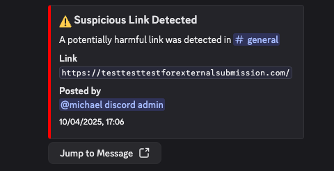

## Problemas comunes

<Frame>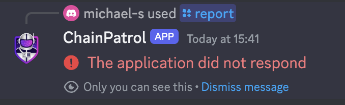</Frame>

### Permisos elevados personalizados

- Es posible que el rol del bot necesite permisos elevados para interactuar con canales privados

- Si vas a agregar el bot a un canal que normalmente no es visible para `@everyone`, entonces tendrás que
  Comandos de barra no visibles para los miembros de Discord

  <CardGroup cols={2}>
    <Card title="Permisos de canal privado" icon="square-1">
      <Frame>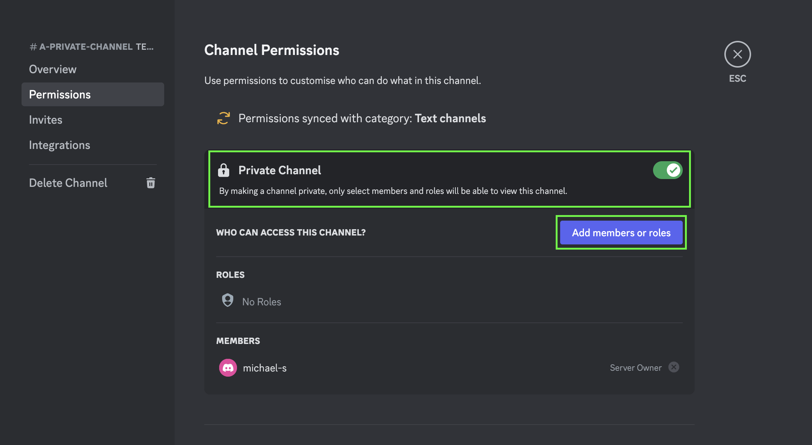</Frame>
    </Card>
    <Card title="Agregar el bot de ChainPatrol" icon="square-2">
      <Frame>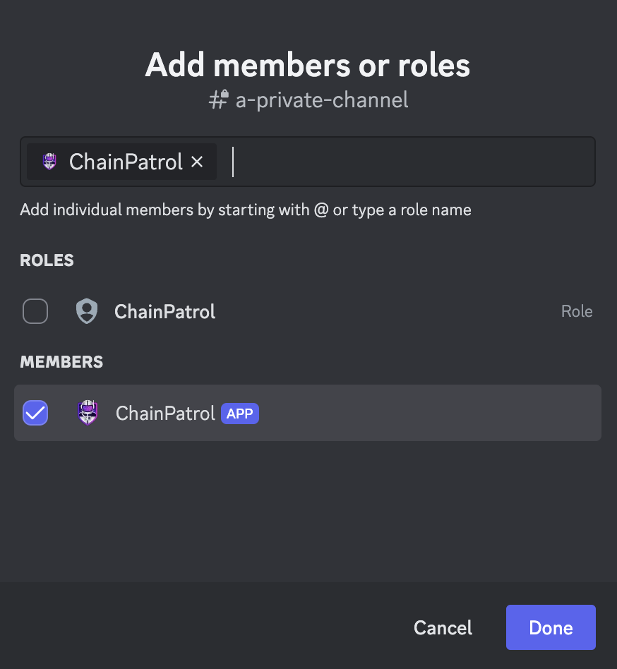</Frame>
    </Card>
  </CardGroup>

- Se requieren permisos para insertar enlaces (embed links) para tu feed de reportes

  <Frame>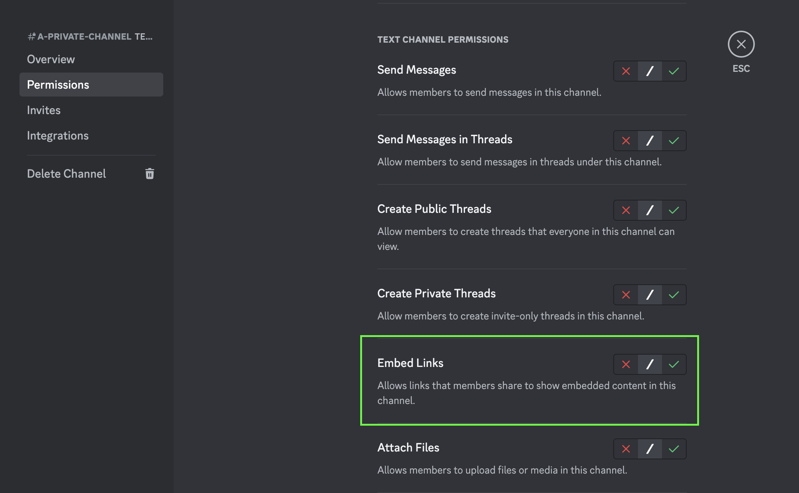</Frame>

- Haz que los comandos de aplicación estén disponibles para los usuarios
  - Los miembros del servidor no podrán usar los comandos del bot de ChainPatrol si no tienen acceso a los comandos de aplicación
    <Frame>
      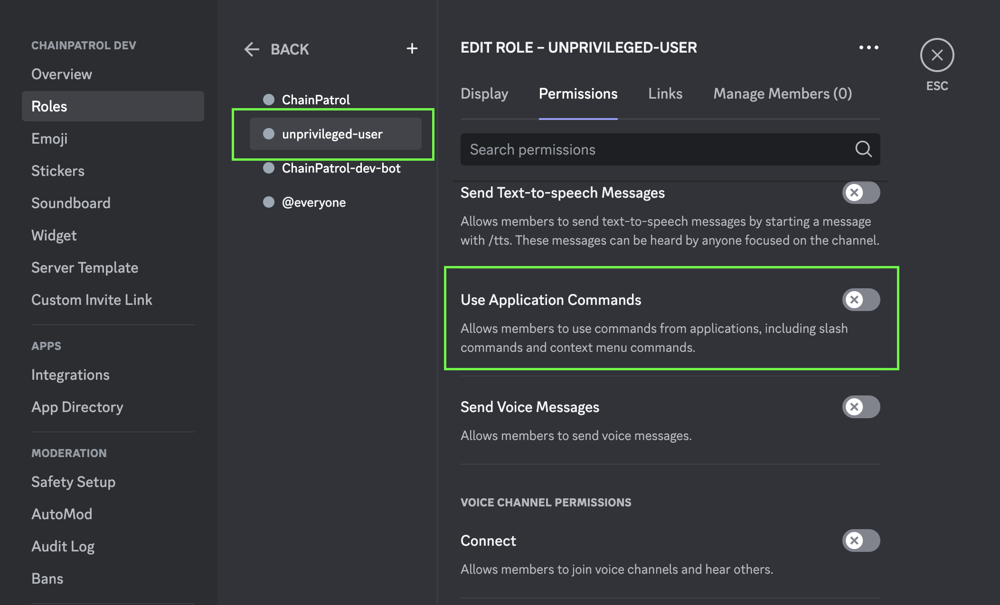
    </Frame>

## Consejos de depuración

### Ver el servidor como un rol

- Puedes hacer clic derecho en el rol de ChainPatrol en la configuración del servidor para ver el servidor como el rol del bot

  <Frame>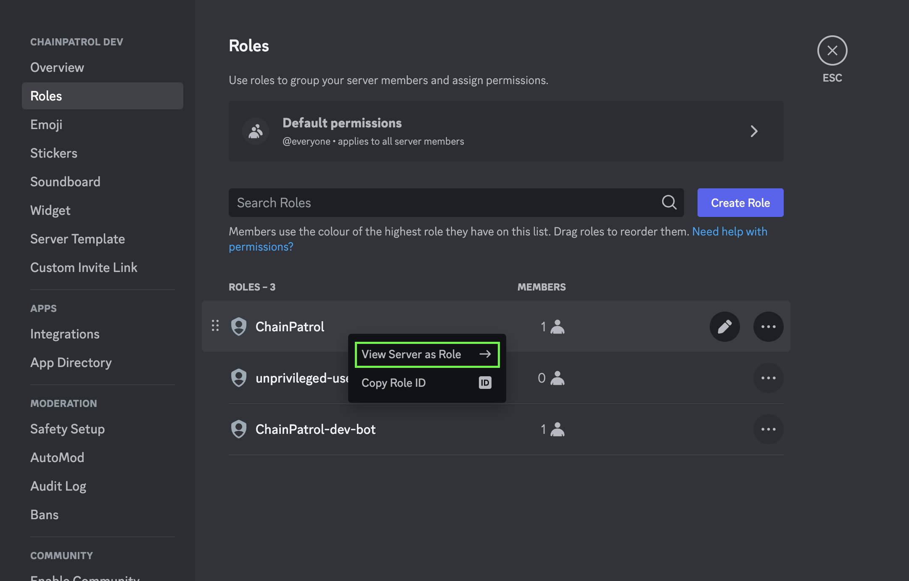</Frame>

<Tip>
  Intentar acceder a una función en una parte inaccesible del servidor provocará
  un error. Asegúrate de que los permisos del bot le permitan ver e interactuar con lo que
  estás depurando.

¡Consulta el artículo [Role Management 101 de Discord](https://support.discord.com/hc/en-us/articles/214836687-Role-Management-101) para obtener más ayuda!

</Tip>

## Privacidad

El bot no recopila ninguna información personal. Solo recopila la URL y
el ID de Discord del usuario que envió el reporte (por si un moderador necesita
más información sobre por qué la URL es una estafa).

Por cada servidor conectado, ChainPatrol almacena el ID del servidor y la configuración del bot para ese servidor: los
canales que monitorea u omite, los roles de moderador, los nombres de usuario y el canal a los que notifica, y el
canal donde publica los reportes.

Para más información, lee la [política de privacidad](https://chainpatrol.com/legal/privacy) de ChainPatrol.

## Código fuente

El código fuente del bot está disponible en GitHub:
[chainpatrol/discord-bot](https://github.com/chainPatrol/discord-bot)
