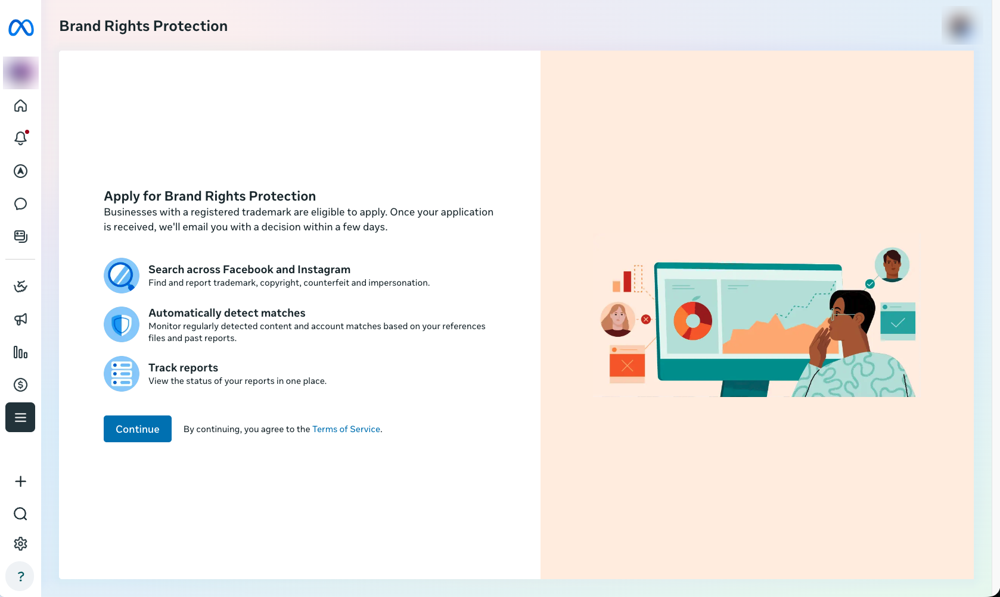
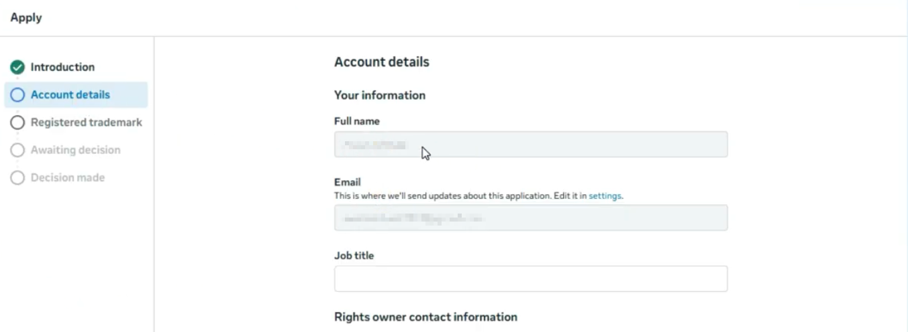
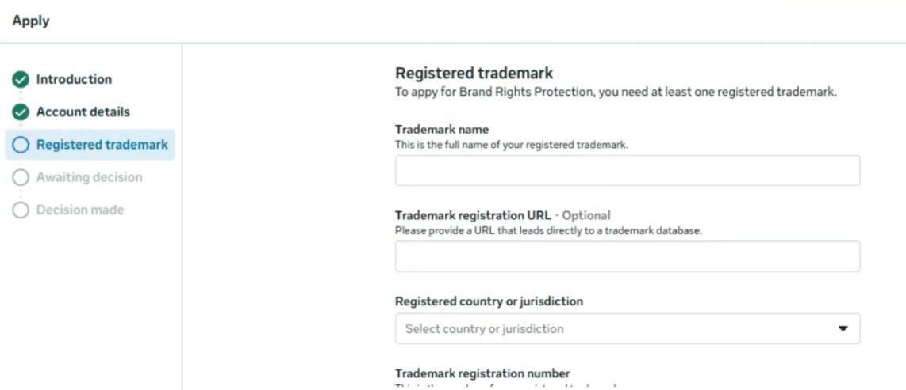
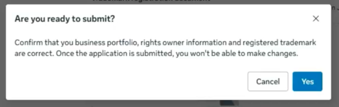
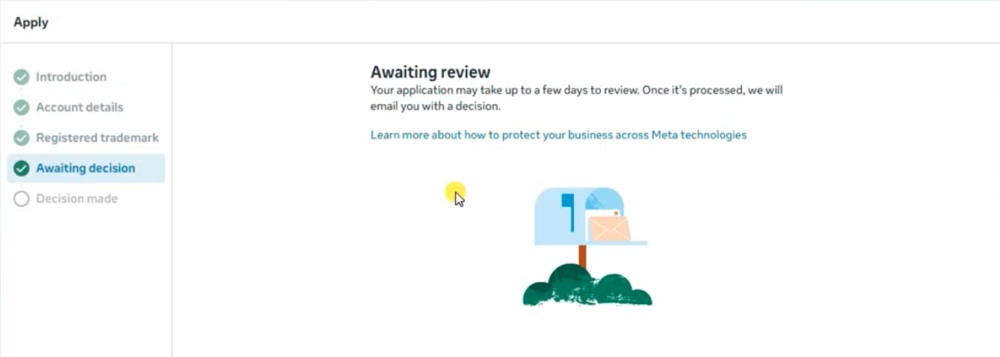
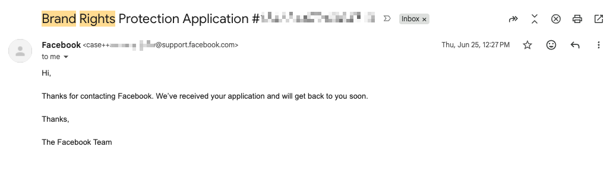

[Brand Rights Protection](https://www.facebook.com/business/help/828925381043253) es el programa de Meta para titulares de marcas registradas. Le permite a una marca encontrar y reportar contenido relacionado con marcas registradas, derechos de autor, falsificaciones y suplantación en Facebook e Instagram, y sus reportes se gestionan más rápido que los de los formularios públicos de reporte de Meta.

Meta solo acepta solicitudes de la propia marca, así que **la solicitud tiene que hacerla tu equipo**. Una vez que te aprueben, trabajamos contigo para presentar [**Takedowns**](/es/concepts/takedowns) (solicitudes de baja de contenido fraudulento) en Facebook e Instagram en tu nombre.

Configurar esto te toma unos 30 minutos, más 1–2 días para que Meta revise tu solicitud.

## Requisitos previos

Antes de empezar, asegúrate de tener:

- **Una forma de iniciar sesión en Meta Business Suite**: ya sea una cuenta personal de Facebook o una Meta Managed Account si tu empresa usa SSO.
- **Un business portfolio** (portafolio comercial) en [Meta Business Suite](https://business.facebook.com/) sobre el que tengas **Full control** (control total). Si tu empresa todavía no tiene uno, puedes crearlo al iniciar sesión.
- **Una marca registrada** (trademark) que corresponda a tu marca, con su número de registro y una copia escaneada del documento de registro.
- **La autoridad para presentar la solicitud.** El solicitante debe ser un empleado o representante legal de la marca.

## Solicita Brand Rights Protection

<Steps>
  <Step title="Abre Brand Rights Protection">
    Ve a [business.facebook.com/latest/brand_rights_protection](https://business.facebook.com/latest/brand_rights_protection/), elige tu business portfolio y haz clic en **Continue** para iniciar la solicitud.

    <Frame></Frame>

  </Step>
  <Step title="Completa los datos de tu cuenta">
    **Your information** (tu información)

    - **Full name** (nombre completo): se completa automáticamente con los datos de tu cuenta
    - **Email** (correo electrónico): debe ser una dirección de correo de la empresa
    - **Job title** (cargo): tu puesto, por ejemplo _Head of Marketing_

    **Rights owner contact information** (información de contacto del titular de los derechos)

    - **Organization or client name** (nombre de la organización o del cliente): el nombre de tu empresa
    - **Mailing address** (dirección postal): la dirección postal de tu empresa
    - **Email** (correo electrónico): una dirección de correo de la empresa que una parte reportada pueda usar para contactarte
    - **Phone number** (número de teléfono)
    - **Website** (sitio web)

    <Frame></Frame>

  </Step>
  <Step title="Completa la información de tu marca registrada">
    - **Trademark name** (nombre de la marca registrada): el nombre completo de tu marca registrada
    - **Trademark registration URL** (URL del registro de la marca, opcional): un enlace a la marca registrada en la USPTO, la WIPO o una base de datos similar
    - **Registered country or jurisdiction** (país o jurisdicción de registro)
    - **Trademark registration number** (número de registro de la marca)
    - **Trademark registration document** (documento de registro de la marca): imágenes escaneadas de tus documentos de registro

    <Frame></Frame>

  </Step>
  <Step title="Envía la solicitud">
    Haz clic en **Submit** y luego en **Yes** para confirmar. No puedes editar la solicitud después de enviarla, así que revísala antes.

    <Frame></Frame>

  </Step>
</Steps>

Una vez enviada, verás una pantalla **Awaiting review** (en espera de revisión):

<Frame></Frame>

También recibirás un correo de Facebook que confirma que se recibió tu solicitud:

<Frame></Frame>

Meta suele revisar las solicitudes en un plazo de **24–48 horas**. Cuando aprueben la tuya, recibirás un correo con un enlace a los próximos pasos.

## Próximos pasos

Una vez que Meta apruebe tu solicitud, **avísale a tu contacto de ChainPatrol**. Te guiaremos para darle acceso a ChainPatrol, de modo que podamos reportar suplantaciones en Facebook e Instagram en tu nombre.

## Recursos

- [Acerca de Brand Rights Protection](https://www.facebook.com/business/help/828925381043253)
- [Solicitar Brand Rights Protection](https://business.facebook.com/latest/brand_rights_protection/)
