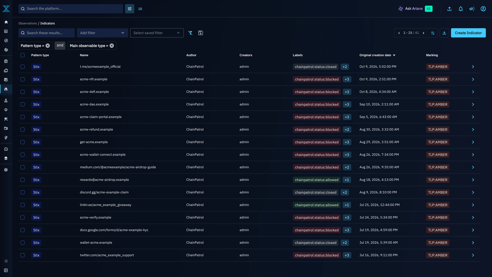
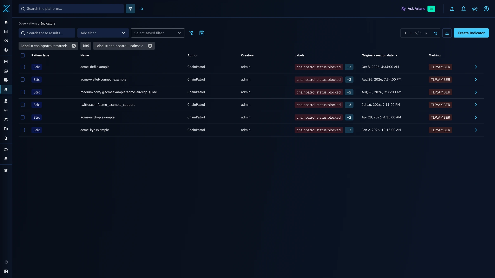
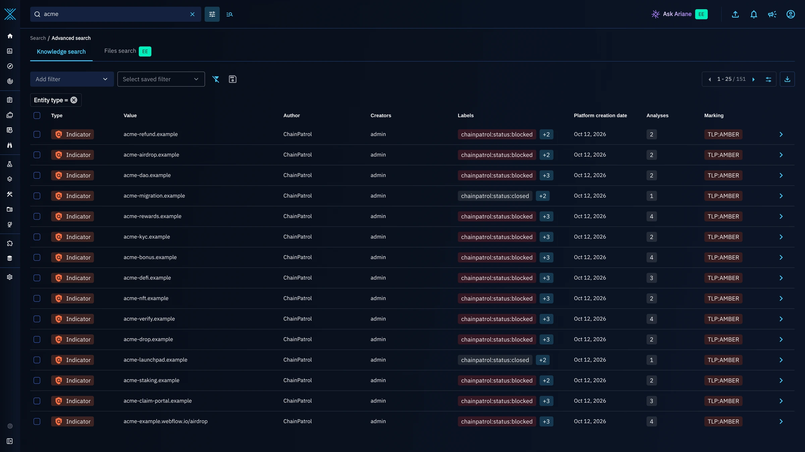
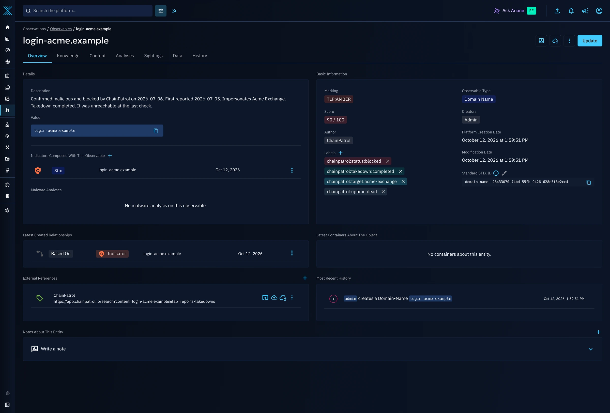
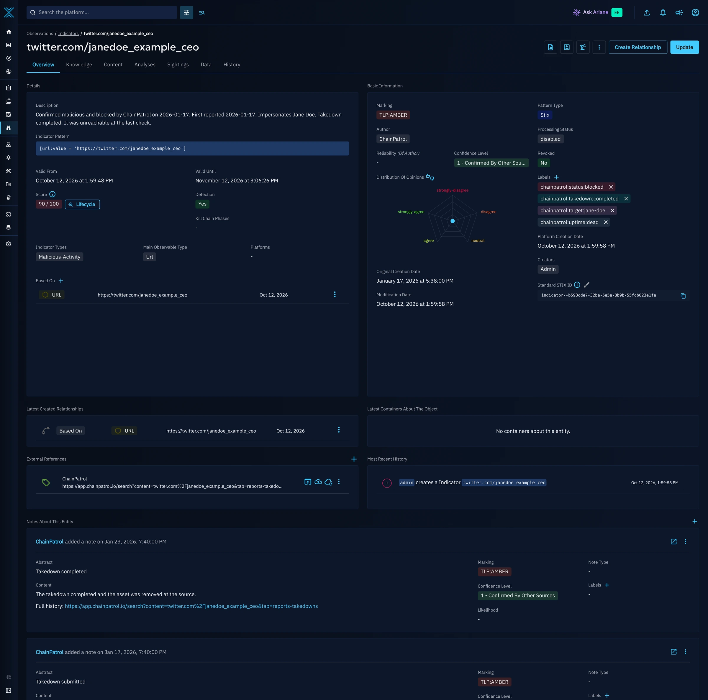
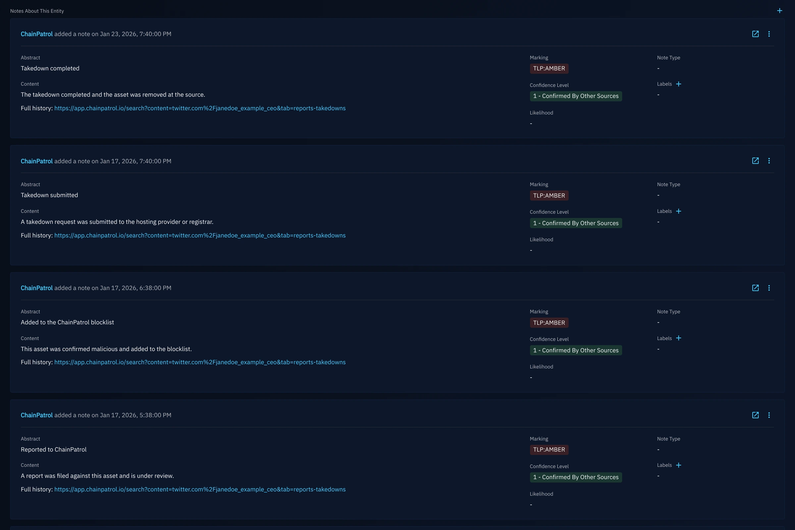
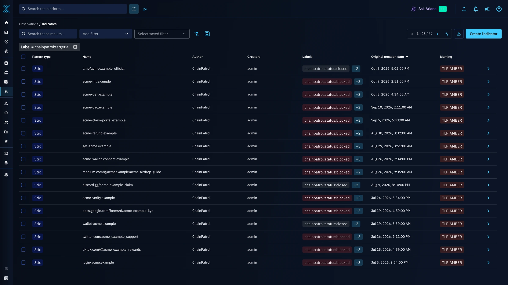
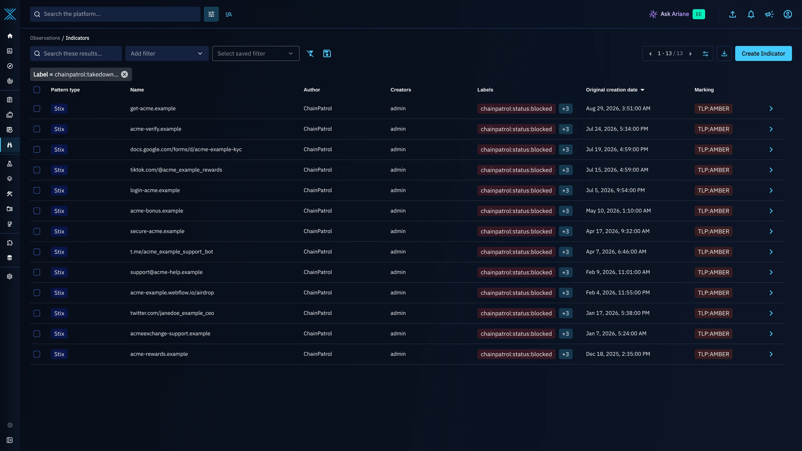
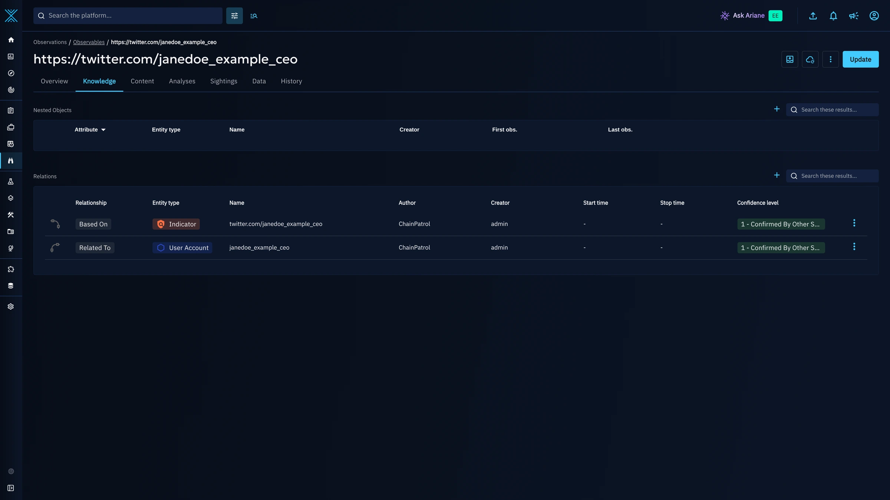

El conector de ChainPatrol para OpenCTI es un conector de tipo **external-import** para [OpenCTI](https://filigran.io/solutions/open-cti/). Importa las amenazas que ChainPatrol investiga para tu organización y, opcionalmente, la **Blocklist** (lista de bloqueo) global, como indicadores y observables sobre los que tus analistas pueden pivotar y a los que tus reglas de detección pueden aplicar umbrales.

Es un conector de tipo **pull**: lo ejecutas dentro de tu red, contra tu propio OpenCTI. ChainPatrol nunca necesita una ruta de entrada a tu infraestructura.

## Inicio rápido

Necesitas un OpenCTI **7.261008.0** en ejecución con Docker Compose y una clave de API de ChainPatrol. Para instalar OpenCTI primero, sigue la [guía de despliegue de Filigran](https://docs.opencti.io/latest/deployment/installation/).

<Steps>
  <Step title="Crea una clave de API de ChainPatrol">
    En el [**Dashboard** (panel principal) de ChainPatrol](https://app.chainpatrol.io/admin), abre **Developer › API Keys** (claves de API) en la barra lateral y crea una clave.
  </Step>
  <Step title="Agrega el conector al docker-compose.yml de tu OpenCTI">
    Agrega este servicio junto a tus servicios de OpenCTI existentes:

    ```yaml
      connector-chainpatrol:
        image: chainpatrol/opencti-connector:latest
        environment:
          - OPENCTI_URL=http://opencti:8080
          - OPENCTI_TOKEN=${OPENCTI_ADMIN_TOKEN}
          - CONNECTOR_ID=${CONNECTOR_CHAINPATROL_ID}   # any UUIDv4: run `uuidgen`
          - CONNECTOR_TYPE=EXTERNAL_IMPORT
          - CONNECTOR_NAME=ChainPatrol
          - CONNECTOR_SCOPE=chainpatrol
          - CONNECTOR_LOG_LEVEL=info
          - CONNECTOR_DURATION_PERIOD=PT1H
          - CHAINPATROL_API_KEY=${CHAINPATROL_API_KEY}
        read_only: true
        cap_drop: [ALL]
        security_opt: [no-new-privileges:true]
        restart: always
    ```

    Luego agrega `CONNECTOR_CHAINPATROL_ID` y `CHAINPATROL_API_KEY` al archivo `.env` que está junto a él.
  </Step>
  <Step title="Inícialo">
    ```bash
    docker compose up -d connector-chainpatrol
    docker compose logs -f connector-chainpatrol
    ```

    En menos de un minuto, el log muestra `Polling the organization threat feed` y luego un resumen como `Organization threats: 120 fetched, 118 converted`. Si alguna configuración es incorrecta, el conector se cierra con un mensaje de una línea que la nombra, por ejemplo `ChainPatrol rejected CHAINPATROL_API_KEY (401)`.
  </Step>
  <Step title="Ve tus amenazas en OpenCTI">
    El conector aparece en **Integrations → Deployed**. Tus amenazas aparecen en **Observations → Indicators**, cada una etiquetada con su estado en ChainPatrol. La primera sincronización importa todo tu historial; los workers de OpenCTI pueden tardar varios minutos en escribirlo todo, así que aumenta su cantidad si tu organización es grande. Después de eso, el conector busca cambios cada hora.
  </Step>
</Steps>

<Tip>
El ejemplo usa el token de administrador por brevedad. Para cualquier uso que vaya más allá de una prueba, ejecuta el conector con su propio usuario de OpenCTI: crea uno en **Settings → Security → Users**, agrégalo a un grupo con el rol Connector (OpenCTI incluye uno llamado *Connectors*) y define `OPENCTI_TOKEN` con su token de API. Así, cada entidad importada muestra a ese usuario como su creador en lugar de `admin`, por lo que los datos de ChainPatrol son fáciles de filtrar, y recibe el nivel de confianza de ese grupo en lugar del nivel del administrador.
</Tip>

El resto de esta página explica qué importa el conector, cómo configurarlo y cómo investigar con él en OpenCTI.

## Qué importa

El conector tiene dos feeds, que se configuran de forma independiente. La mayoría de los despliegues solo necesita el primero.

### Las amenazas de tu organización (activadas de forma predeterminada)

Todo lo que ChainPatrol ha investigado en tu nombre, **desde el momento en que se presenta un reporte**, no solo una vez que se confirma. Cada **Asset** (activo digital: URL, dirección, perfil, app, etc.) lleva etiquetas que describen en qué punto de su ciclo de vida se encuentra:

| Etiqueta | Significado |
| --- | --- |
| `chainpatrol:status:investigating` | Se presentó un reporte y está en revisión |
| `chainpatrol:status:escalated` | ChainPatrol lo pasó a tu equipo para que tome una decisión |
| `chainpatrol:status:blocked` | Confirmado como malicioso y en la [Blocklist](/es/concepts/blocklist) |
| `chainpatrol:status:allowed` | Descartado como falso positivo. El indicador queda **revocado** |
| `chainpatrol:status:closed` | Revisado, pero ni bloqueado ni descartado |
| `chainpatrol:takedown:open` \| `submitted` \| `completed` \| `cancelled` \| `retracted` | Progreso del [**Takedown**](/es/concepts/takedowns) (solicitud de baja de contenido fraudulento) |
| `chainpatrol:target:<slug>` | A cuál de tus [marcas](/es/concepts/brands) suplanta |
| `chainpatrol:uptime:alive` \| `dead` \| `unknown` | Si el asset estaba accesible en la última comprobación |

Las etiquetas están tanto en el indicador como en el observable. Los nombres de las etiquetas se eligieron para que el estado quede primero al ordenar. OpenCTI ordena alfabéticamente las etiquetas de una entidad y sus vistas de lista muestran solo la primera, así que el estado es la etiqueta que ves en todas las listas.

<Note>
Las versiones del conector anteriores a octubre de 2026 usaban `chainpatrol:brand:*` y `chainpatrol:liveness:*`. La primera ejecución después de actualizar vuelve a enviar una vez las amenazas de tu organización y reemplaza las etiquetas antiguas a medida que avanza.
</Note>

Este feed se marca como **TLP:AMBER** de forma predeterminada, porque menciona tus marcas y tus investigaciones abiertas.

### La Blocklist global (desactivada de forma predeterminada)

Todos los assets de la Blocklist de ChainPatrol, aproximadamente 500,000 entidades, **sin contexto de organización**: sin marcas, sin historial de reportes, sin progreso de takedowns. Cada asset lleva la etiqueta `chainpatrol:status:blocked`.

Este feed se marca como **TLP:CLEAR** de forma predeterminada. Está desactivado de forma predeterminada porque la primera ejecución importa toda la Blocklist.

<Note>
Si habilitas ambos feeds, un asset que está en la Blocklist global *y* que fue reportado para tu organización lleva tanto TLP:CLEAR como TLP:AMBER. Es intencional: el hecho de que esté bloqueado es público, pero el contexto de la investigación que lo rodea no lo es.
</Note>

## Cómo se modela cada asset

Cada asset se convierte en hasta cuatro tipos de objeto de OpenCTI:

- **Indicator** (indicador): un patrón STIX como `[url:value = 'https://…']`, que lleva las etiquetas, el puntaje y, para los assets descartados, `revoked: true`.
- **Observable**: el asset en sí, que lleva las mismas etiquetas, puntaje y resumen que el indicador. El indicador se vincula a él con una relación `based-on`.
- **User-Account**: para los perfiles de redes sociales, el handle (nombre de usuario), vinculado al observable con `related-to`.
- **Notes** (notas): una por cada transición del ciclo de vida (reportado, escalado, bloqueado, takedown enviado…), cada una con un enlace a la página del asset en ChainPatrol.

| Tipo de asset de ChainPatrol | Ejemplo | Observable de OpenCTI |
| --- | --- | --- |
| `URL` | `evil.example` | Domain-Name |
| `PAGE` | `linktr.ee/evil` | Url |
| Plataformas sociales (`TWITTER`, `TELEGRAM`, `DISCORD`, …) | `twitter.com/evil` | Url, más User-Account para los perfiles |
| `EMAIL` | `scam@evil.example` | Email-Addr |
| `PHONE_NUMBER` | `+15550001111` | Phone-Number |

Las direcciones cripto (`ADDRESS`) y las direcciones IP todavía no se importan.

Tanto el indicador como el observable llevan un resumen de una línea del asset, por ejemplo *"Confirmed malicious and blocked by ChainPatrol on 2026-01-17. First reported 2026-01-17. Impersonates Jane Doe. Takedown completed. It was unreachable at the last check."*, y un enlace a la página del asset en ChainPatrol. Sin importar a cuál de los dos llegue primero un analista, tendrá la historia completa.

## Validez y decaimiento

La fecha **valid from** (válido desde) de un indicador es el momento de la sincronización que lo envió, no la fecha en que el asset fue reportado o bloqueado. OpenCTI inicia su reloj de decaimiento en esa fecha, así que una fecha histórica haría que la mayor parte de tu historial llegara ya vencida: OpenCTI revocaría un sitio de phishing bloqueado hace un año que ChainPatrol sigue bloqueando. Las fechas reales se conservan como la **original creation date** (fecha de creación original) del indicador y en sus notas.

El conector solo vuelve a enviar los assets que cambiaron, por lo que además **vuelve a enviar todos los assets bloqueados cada 7 días** (`CHAINPATROL_REFRESH_INTERVAL_DAYS`). Eso reinicia su decaimiento antes de que se agote la vida útil integrada más corta de OpenCTI, de modo que un asset bloqueado permanece activo mientras ChainPatrol lo bloquee. Los assets en cualquier otro estado se dejan decaer normalmente.

La Blocklist global es demasiado grande para actualizarla de esta forma. Sus entradas decaen a menos que ChainPatrol las actualice. Si eso es importante para ti, agrega en OpenCTI una regla de exclusión de decaimiento para ellas.

## Puntajes

Cada indicador lleva un `x_opencti_score` que refleja qué tan seguro está ChainPatrol, para que puedas crear reglas de detección basadas en un umbral. **Solo los assets bloqueados se marcan para detección** (`x_opencti_detection: true`). Un reporte abierto es una afirmación, no un hallazgo.

| Estado | Puntaje predeterminado | Marcado para detección |
| --- | --- | --- |
| `investigating` / `closed` | 25 | No |
| `escalated` | 50 | No |
| `blocked` | 90 | **Sí** |
| `allowed` | 0 | No, y el indicador se revoca |

Puedes cambiar cualquiera de estos puntajes. Consulta [Configuración](#configuración).

<Warning>
Las reglas integradas de decaimiento de indicadores de OpenCTI revocan los indicadores cuyo puntaje baja a 20 o menos, y reducen todos los puntajes con el tiempo. Mantén los reportes abiertos por encima de 20, o las investigaciones abiertas se revocarán apenas lleguen. Los indicadores de URL son los que decaen más rápido con las reglas predeterminadas, así que, si quieres que los reportes abiertos de URL se mantengan activos por mucho tiempo, sube su puntaje o ajusta tus reglas de decaimiento en OpenCTI, en **Settings → Customization → Decay rules**.
</Warning>

## Configuración

Cada ajuste es una variable de entorno. Al ejecutar desde el código fuente, los mismos ajustes pueden ir en `config.yml` bajo `chainpatrol:`, usando el nombre en minúsculas sin el prefijo (por ejemplo, `CHAINPATROL_ORG_FEED_TLP` pasa a ser `org_feed_tlp`). Las variables de entorno tienen prioridad sobre el archivo.

| Variable | Valor predeterminado | Notas |
| --- | --- | --- |
| `CHAINPATROL_API_KEY` | — | **Obligatoria** |
| `CHAINPATROL_ORGANIZATION_SLUG` | — | Solo es necesaria si tu clave puede acceder a varias organizaciones |
| `CHAINPATROL_ORG_FEED_ENABLED` | `true` | Las amenazas de tu organización |
| `CHAINPATROL_ORG_FEED_TLP` | `amber` | `clear`, `green`, `amber`, `amber+strict` o `red` |
| `CHAINPATROL_ORG_FEED_PAGE_SIZE` | `100` | 1–1000 |
| `CHAINPATROL_BLOCKLIST_FEED_ENABLED` | `false` | La Blocklist global |
| `CHAINPATROL_BLOCKLIST_FEED_TLP` | `clear` | |
| `CHAINPATROL_BLOCKLIST_FEED_PAGE_SIZE` | `1000` | 1–1000 |
| `CHAINPATROL_POLL_OVERLAP_MINUTES` | `10` | Consulta [Polling](#polling) |
| `CHAINPATROL_REFRESH_INTERVAL_DAYS` | `7` | Cada cuánto se vuelven a enviar todos los assets bloqueados. Consulta [Validez y decaimiento](#validez-y-decaimiento). `0` lo desactiva |
| `CHAINPATROL_SCORE_INVESTIGATING` | `25` | Puntaje para cada estado del ciclo de vida, 0–100 |
| `CHAINPATROL_SCORE_CLOSED` | `25` | |
| `CHAINPATROL_SCORE_ESCALATED` | `50` | |
| `CHAINPATROL_SCORE_BLOCKED` | `90` | Debe ser al menos tan alto como todos los demás puntajes. También se usa para la Blocklist global |
| `CHAINPATROL_SCORE_ALLOWED` | `0` | Los assets permitidos (`allowed`) se revocan sea cual sea su puntaje |
| `CONNECTOR_DURATION_PERIOD` | `PT1H` | Tiempo entre ejecuciones, como duración ISO-8601 |

El conector verifica su configuración antes de registrarse en OpenCTI. Si algo está mal, se cierra con un mensaje de una línea que nombra el ajuste que falla, por ejemplo `ChainPatrol rejected CHAINPATROL_API_KEY (401)` o `OpenCTI rejected OPENCTI_TOKEN`. Verifica que:

- `OPENCTI_URL`, `OPENCTI_TOKEN` y `CONNECTOR_ID` estén definidos, y que `CONNECTOR_ID` sea un UUID;
- OpenCTI acepte `OPENCTI_TOKEN` y ChainPatrol acepte `CHAINPATROL_API_KEY`;
- al menos un feed esté habilitado, cada TLP, tamaño de página y puntaje esté dentro del rango, y ningún estado tenga un puntaje mayor que `blocked`.

Revisa los logs del conector con `docker compose logs connector-chainpatrol` si no aparece en OpenCTI después de un minuto.

## Polling

La **primera ejecución es un backfill completo**: se importan todas las amenazas de tu historial. Las ejecuciones posteriores solo obtienen lo que cambió desde la ejecución anterior.

Cada ejecución retrocede su punto de inicio según `CHAINPATROL_POLL_OVERLAP_MINUTES` para que nunca se pierda un cambio que llegue a mitad de una ejecución. Volver a leer unos minutos es inofensivo, porque cada actualización es un upsert. Si una ejecución falla, la siguiente reintenta la misma ventana en lugar de omitirla.

<Tip>
Un backfill completo de una organización grande puede generar bastante más de cien mil mensajes en la cola de OpenCTI. Aumenta la cantidad de workers de OpenCTI para la primera sincronización.
</Tip>

## Las etiquetas que agregas están a salvo

OpenCTI agrega etiquetas sin eliminar las anteriores, así que un asset que pasó de `investigating` a `blocked` llevaría ambas de no ser por el conector. Antes de cada actualización, el conector elimina la etiqueta `chainpatrol:status:*`, `chainpatrol:takedown:*` y `chainpatrol:uptime:*` desactualizada. Nunca elimina las etiquetas `chainpatrol:target:*`, ya que pueden aplicar varias marcas, y nunca toca las etiquetas fuera del prefijo `chainpatrol:`, así que las etiquetas de tus analistas y las de otros conectores quedan intactas.

## Investigar en OpenCTI

Una vez que se ejecutó la primera sincronización, los ejemplos siguientes funcionan en cualquier instancia de OpenCTI que tenga el conector instalado. Las capturas de pantalla usan datos de ejemplo inventados para una marca ficticia, Acme Exchange.

<Frame></Frame>

### Encuentra lo que sigue activo

Abre **Observations → Indicators**, agrega un filtro **Label** para `chainpatrol:status:blocked` y un segundo para `chainpatrol:uptime:alive`. Lo que queda es cada sitio de phishing confirmado, perfil falso o página de estafa que todavía estaba accesible en la última comprobación de ChainPatrol. Esos son los que hay que bloquear primero o escalar. Guarda el filtro para conservarlo como una cola de trabajo permanente.

<Frame></Frame>

El color de la etiqueta de estado te indica el estado de un vistazo: rojo para `blocked`, naranja para `escalated`, amarillo para `investigating`, gris para `closed` y verde para `allowed`. En una pantalla angosta el texto de la etiqueta puede cortarse, pero el color se sigue viendo.

### Verifica un dominio, URL o handle a partir de una alerta

Pega el valor de una alerta del SIEM, de un correo reportado o de un ticket de soporte en la búsqueda global de OpenCTI. Cada coincidencia muestra su estado en ChainPatrol, y la columna **Analyses** cuenta sus notas de ciclo de vida.

<Frame></Frame>

Abre el observable para ver el resumen de una línea, el puntaje, las etiquetas y un enlace al asset en ChainPatrol. No necesitas entrar al indicador.

<Frame></Frame>

### Sigue un caso desde el reporte hasta el takedown

Abre el indicador. Su **original creation date** es el momento en que ChainPatrol vio el asset por primera vez. **Valid from** es la sincronización que lo envió, lo que mantiene el decaimiento de OpenCTI corriendo desde hoy y no desde el primer reporte. **Detection** está activado solo para los assets bloqueados.

<Frame></Frame>

Desplázate hasta **Notes about this entity** para ver la línea de tiempo, de lo más reciente a lo más antiguo: reportado, escalado, bloqueado, takedown enviado y takedown completado. Cada nota enlaza a la página del asset en ChainPatrol, donde están los reportes, la evidencia y el historial de takedowns.

<Frame></Frame>

### Ve todo lo que suplanta a una marca

Filtra por `chainpatrol:target:<your-brand>` para delimitar una campaña. Las marcas y las personas que ChainPatrol protege para ti, como los ejecutivos, tienen cada una su propia etiqueta. Agrega una etiqueta de estado o de takedown para acotarlo más, por ejemplo, todo lo que apunta a tu marca y sigue en investigación.

<Frame></Frame>

### Da seguimiento a los takedowns

`chainpatrol:takedown:completed`, `submitted`, `open`, `cancelled` y `retracted` muestran en qué punto está cada eliminación. Usa el botón de exportar en una lista filtrada para tus propios informes.

<Frame></Frame>

### Pivota de un perfil social a la cuenta

Un perfil de redes sociales se convierte en un observable de tipo URL vinculado a un **User-Account** que contiene el handle. Abre la pestaña **Knowledge** del observable para llegar a él y usa el handle para correlacionar con tus otras fuentes.

<Frame></Frame>

### Crea detecciones solo con amenazas confirmadas

Apunta las reglas de detección y las exportaciones a los indicadores con **Detection = Yes**, o con un puntaje de al menos 90. Ese es exactamente el conjunto de bloqueados. Los reportes abiertos (puntaje 25) y los falsos positivos descartados (puntaje 0, revocados) quedan fuera de tus listas de bloqueo.

## Soporte

Para obtener ayuda con el conector, tus datos o tu clave de API, escribe a [support@chainpatrol.io](mailto:support@chainpatrol.io).
