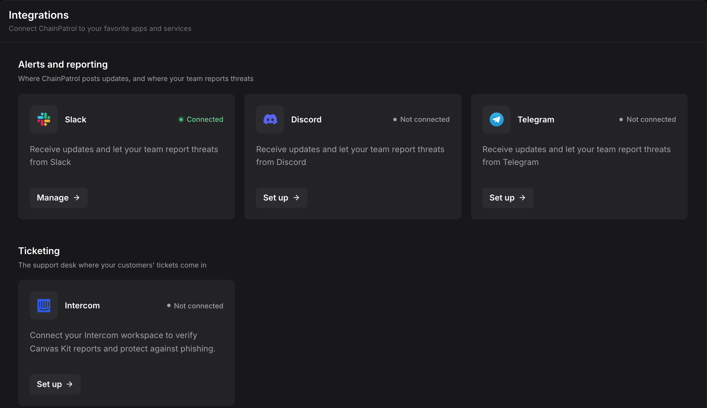
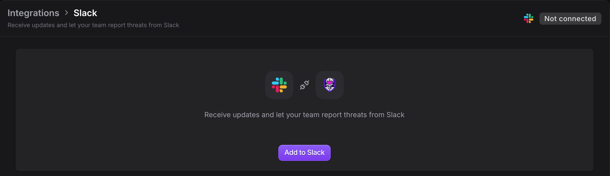
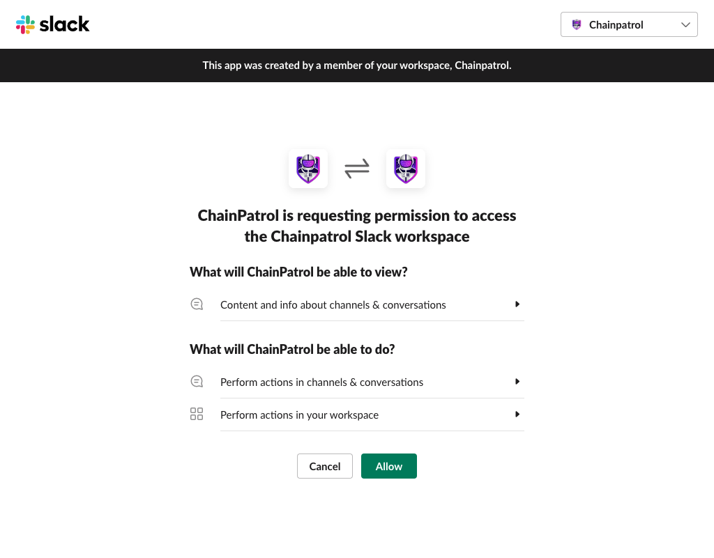
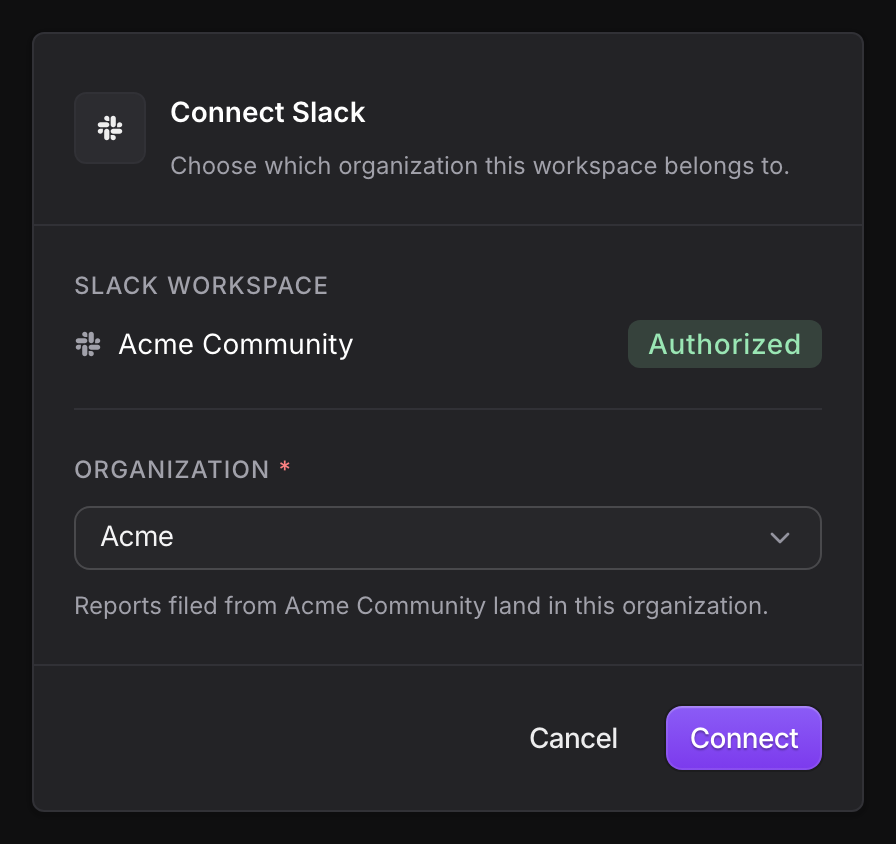
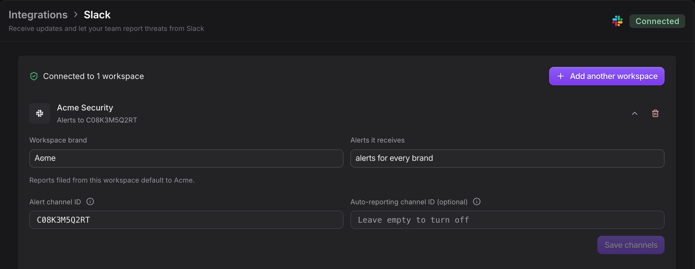
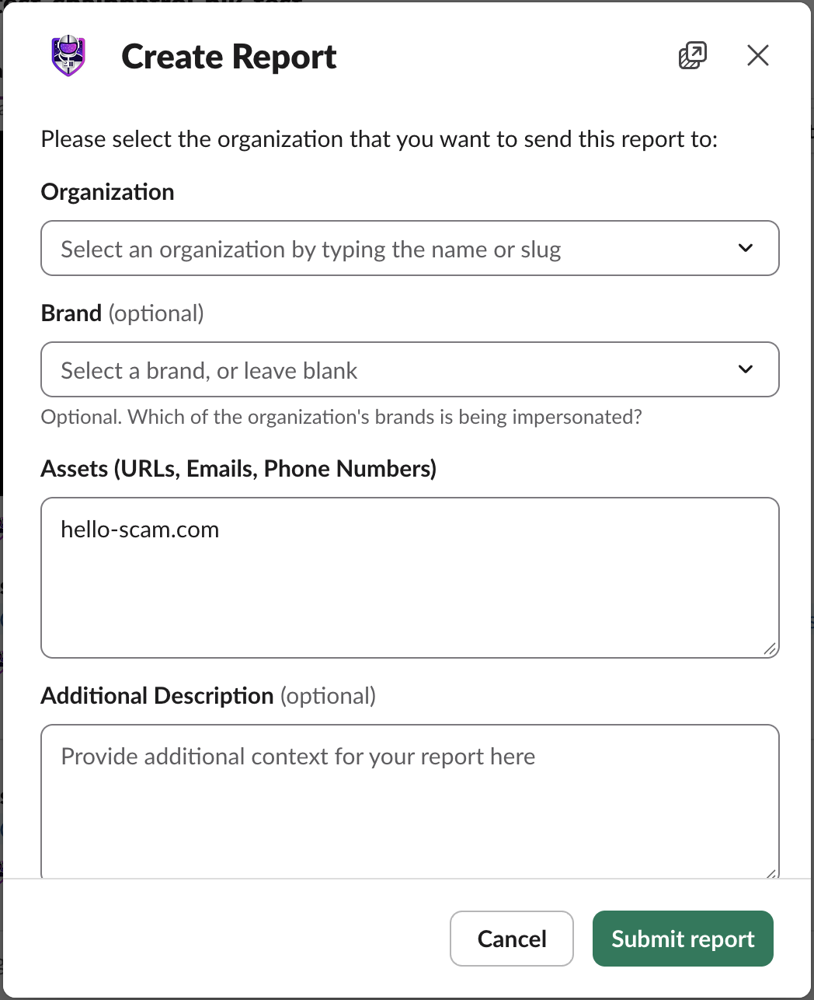
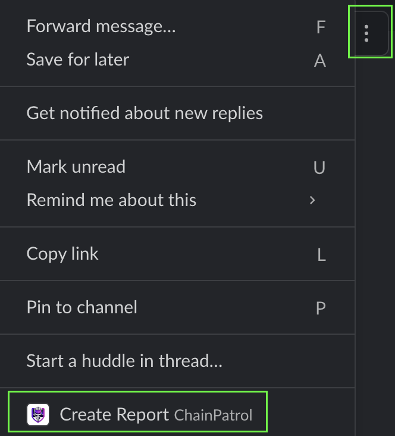
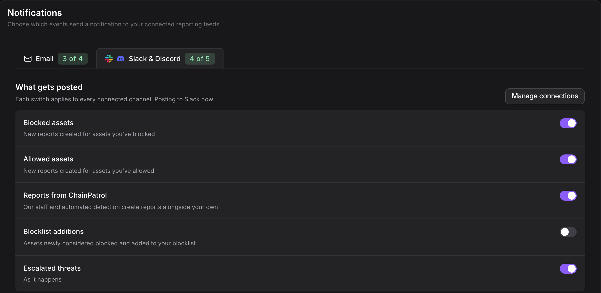

El bot de Slack de ChainPatrol conecta tu espacio de trabajo de Slack con tu organización de ChainPatrol. Con él, tu equipo puede:

- **Reportar amenazas desde Slack**: enlaces, correos electrónicos y números de teléfono, con un comando de barra o desde cualquier mensaje.
- **Recibir alertas en un canal**: nuevos reportes, incorporaciones a la **Blocklist** (lista de bloqueo) y **Proposals** (propuestas para bloquear o permitir un asset) que necesitan tu revisión.
- **Preguntarle al ChainPatrol Assistant**: etiqueta a `@ChainPatrol` en tu canal compartido con ChainPatrol para preguntar sobre tus amenazas y **takedowns** (solicitudes de baja de contenido fraudulento). Consulta [ChainPatrol Assistant](/es/integration/chainpatrol-assistant).

## Configuración

Necesitas ser **Owner** o **Admin** de tu organización de ChainPatrol, y tener permiso para instalar apps en tu espacio de trabajo de Slack.

<Steps>
  <Step title="Abre la integración de Slack">
    En la [app de ChainPatrol](https://app.chainpatrol.io/), ve a **Settings → Integrations** (configuración → integraciones) y selecciona el recuadro **Slack**.

    <Frame></Frame>

  </Step>
  <Step title="Haz clic en Add to Slack">
    Haz clic en **Add to Slack**. Slack abre su pantalla de permisos. Comprueba que el espacio de trabajo que aparece arriba a la derecha sea el que quieres y luego haz clic en **Allow**.

    <Frame></Frame>
    <Frame></Frame>

  </Step>
  <Step title="Elige tu organización">
    Slack te envía de vuelta a la página **Connect Slack** de ChainPatrol. Inicia sesión si se te pide, elige la organización a la que pertenece este espacio de trabajo y haz clic en **Connect**. Los reportes enviados desde este espacio de trabajo van a la organización que elijas.

    <Frame></Frame>
    <Tip>
      Solo se muestran las organizaciones en las que eres propietario o administrador. El enlace de esta página es válido durante 10 minutos. Si vence, haz clic en **Add to Slack** otra vez.
    </Tip>

  </Step>
  <Step title="Define tu canal de alertas">
    De vuelta en la página de la integración de Slack, tu espacio de trabajo ya aparece en la lista. Para recibir alertas, elige un canal para ellas:

    1. En Slack, abre el canal y envía `/invite @ChainPatrol`.
    2. Abre los detalles del canal. En la pestaña **About**, copia el **Channel ID** (empieza con `C`).
    3. Pégalo en **Alert channel ID** y haz clic en **Save channels**.

    <Frame></Frame>

  </Step>
</Steps>

<Warning>
  Instala la app en un solo espacio de trabajo. Las instalaciones a nivel de organización
  (Enterprise Grid) no son compatibles, y Slack muestra un error si intentas hacer una.
</Warning>

## Reportar amenazas desde Slack

Cualquier persona de un espacio de trabajo conectado puede reportar a tu organización. Cada reporte abre un formulario con estos campos:

| Campo | Notas |
| --- | --- |
| **Organization** | La organización a la que va el reporte. Se completa automáticamente cuando el espacio de trabajo está conectado a una sola organización. De lo contrario, empieza a escribir su nombre o slug y elígela de la lista. |
| **Brand** | Opcional. La marca que está siendo suplantada. Por defecto es la marca del espacio de trabajo, si definiste una. |
| **Assets** | Enlaces, correos electrónicos o números de teléfono, uno por línea. Los assets (activos digitales) que ChainPatrol ya bloqueó, o que están en tu **Allowlist** (lista de permitidos), se rechazan. |
| **Additional Description** | Opcional. Cualquier dato que ayude a la revisión. |
| **Attachments** | Opcional. Hasta 5 capturas de pantalla o archivos. Desplázate hacia abajo, más allá de la descripción, para encontrarlo. |

<Frame></Frame>

### Comando de barra

Escribe `/chainpatrol` seguido de lo que quieres reportar:

```
/chainpatrol https://scam-example.com
/chainpatrol scammer@example.com
/chainpatrol +1-555-123-4567
```

Escribe `/chainpatrol` sin nada más para abrir un formulario vacío. Cuando se crea el reporte, el bot te envía un mensaje directo con un enlace al reporte.

### Desde un mensaje

Pasa el cursor sobre un mensaje, abre el menú **⋮** (más acciones) y selecciona **Create Report**. El formulario se abre con los enlaces de ese mensaje. Cuando se crea el reporte, el bot responde en el hilo del mensaje y agrega una reacción ✅.

<Frame></Frame>

### Después de reportar

La confirmación muestra el ID del reporte, la organización y la marca, con un enlace al reporte en ChainPatrol. También tiene dos botones:

- **Add attachments**: agrega capturas de pantalla si no adjuntaste ninguna. Se muestra solo cuando el reporte no tiene ninguna.
- **Request Change/Cancel**: indícale al equipo de ChainPatrol qué está mal en el reporte, por ejemplo, si reportaste el enlace equivocado.

### En tu canal compartido con ChainPatrol

Si tienes un canal de Slack compartido (Slack Connect) con ChainPatrol, el bot puede hacer más cosas allí:

- **Sugerencias de reporte**: cuando alguien publica un enlace que no está en tu allowlist, el bot responde en el hilo preguntando "Would you like to create a report for:" (¿quieres crear un reporte para…?) con un botón **Report**. La sugerencia vence después de una hora. Después de eso, usa `/chainpatrol` o el menú del mensaje.
- **Reporte automático**: define el canal compartido como tu **Auto-reporting channel ID** en la página de la integración de Slack, y cada enlace que se publique allí se reporta automáticamente. El bot responde en el hilo con el resultado. Si un enlace ya está bloqueado o ya fue reportado, lo indica en su lugar.

<Note>
  El canal de reporte automático debe ser un canal compartido entre tu espacio de trabajo y
  ChainPatrol. Deja el campo vacío para desactivar el reporte automático.
</Note>

## Alertas

El bot publica alertas en el canal de alertas de cada espacio de trabajo. Elige qué alertas publica en **Settings → Notifications** (configuración → notificaciones), en la pestaña **Slack & Discord**.

<Frame></Frame>

| Ajuste | Qué publica |
| --- | --- |
| **Blocked assets** | Nuevos reportes de assets que bloqueaste |
| **Allowed assets** | Nuevos reportes de assets que permitiste |
| **Reports from ChainPatrol** | Reportes que nuestro equipo y la detección automatizada crean junto a los tuyos |
| **Blocklist additions** | Assets recién confirmados como amenazas y agregados a tu blocklist. Desactivado por defecto |
| **Escalated threats** | Amenazas que ChainPatrol deriva a tu equipo para que decida, en el momento en que ocurren |

Cada interruptor se aplica a todos los canales de Slack y Discord conectados. La pestaña muestra cuántos interruptores están activados (por ejemplo, **4 of 5**), y **Manage connections** te lleva a **Settings → Integrations**. Si todavía no hay ningún espacio de trabajo de Slack ni servidor de Discord conectado, la pestaña muestra en su lugar un botón **Connect**.

Las amenazas escaladas también pueden enviarse por correo electrónico. Configúralo en la pestaña **Email** de la misma página.

<Tip>
  **Blocklist additions** es la alerta más importante. Significa que ChainPatrol
  confirmó una amenaza y está trabajando en su takedown y en agregarla a la blocklist. Actívala
  si quieres enterarte de las amenazas confirmadas, no solo de los reportes.
</Tip>

Si [Dark Web Monitoring](/es/concepts/dark-web-monitoring) está activado para tu organización, el bot también publica en tu canal de alertas cuando aumentan las menciones en filtraciones de alguno de tus dominios de correo electrónico monitoreados. Esta alerta no se controla con los ajustes anteriores.

## Administrar espacios de trabajo

Cada espacio de trabajo conectado tiene su propia fila en la página de la integración de Slack, con estos ajustes:

- **Workspace brand**: la marca que se asigna por defecto a los reportes de este espacio de trabajo.
- **Alerts it receives**: alertas de todas las marcas, o solo de una marca. Es útil cuando cada marca tiene su propio equipo y espacio de trabajo.
- **Alert channel ID** y **Auto-reporting channel ID**: consulta [Configuración](#configuración) y [En tu canal compartido](#en-tu-canal-compartido-con-chainpatrol).

También puedes:

- **Add another workspace**: conecta más de un espacio de trabajo de Slack a tu organización. Contacta al soporte de ChainPatrol si las alertas no llegan a los espacios de trabajo adicionales. Un espacio de trabajo también puede conectarse a más de una organización.
- **Update permissions**: se muestra cuando un espacio de trabajo no le ha dado a ChainPatrol todos los permisos de Slack que necesita. Haz clic y vuelve a aprobar en Slack, eligiendo el mismo espacio de trabajo.
- **Disconnect**: haz clic en el ícono de papelera en la fila del espacio de trabajo. Tu organización deja de recibir alertas allí, y las personas de ese espacio ya no pueden enviarle reportes. Para reconectar, haz clic en **Add to Slack** otra vez.

## Solución de problemas

<AccordionGroup>
  <Accordion title="Slack dice que mi equipo no está vinculado a ninguna organización">
    El espacio de trabajo se instaló, pero no se conectó a una organización. Un propietario o administrador puede hacer clic en **Add to Slack** otra vez y elegir la organización en la página **Connect Slack**.
  </Accordion>
  <Accordion title="Las alertas no llegan">
    Comprueba que la fila del espacio de trabajo muestre **Alerts to** con un canal, y no "No alert channel set" (no hay canal de alertas definido). Asegúrate de que el bot esté en ese canal (`/invite @ChainPatrol`) y de que las alertas que esperas estén activadas en **Settings → Notifications**.
  </Accordion>
  <Accordion title="No puedo guardar un ID de canal">
    El canal debe estar en el espacio de trabajo que estás editando. Si es un canal privado, primero agrégale la app de ChainPatrol. Un canal de reporte automático también debe estar compartido con ChainPatrol.
  </Accordion>
  <Accordion title="El formulario de reporte no tiene el campo Attachments">
    Tu espacio de trabajo se instaló antes de que se agregaran los archivos adjuntos. Haz clic en **Update permissions** en la página de la integración de Slack, o instala la app otra vez.
  </Accordion>
</AccordionGroup>

## Privacidad

Cuando alguien reporta desde Slack, el reporte almacena:

- Los assets reportados, la descripción y cualquier archivo adjunto.
- El ID de usuario y el nombre visible en Slack de quien reporta, y la dirección de Slack de tu espacio de trabajo.
- Al reportar desde un mensaje: quién escribió el mensaje, un enlace a él, el nombre del canal y el texto del mensaje.

Por cada espacio de trabajo conectado, ChainPatrol almacena el ID y el nombre del espacio de trabajo, los ID de los canales de alertas y de reporte automático, y la configuración de marca. El bot solo lee los canales a los que fue agregado.

Para más información, lee la [política de privacidad](https://chainpatrol.com/legal/privacy) de ChainPatrol.
