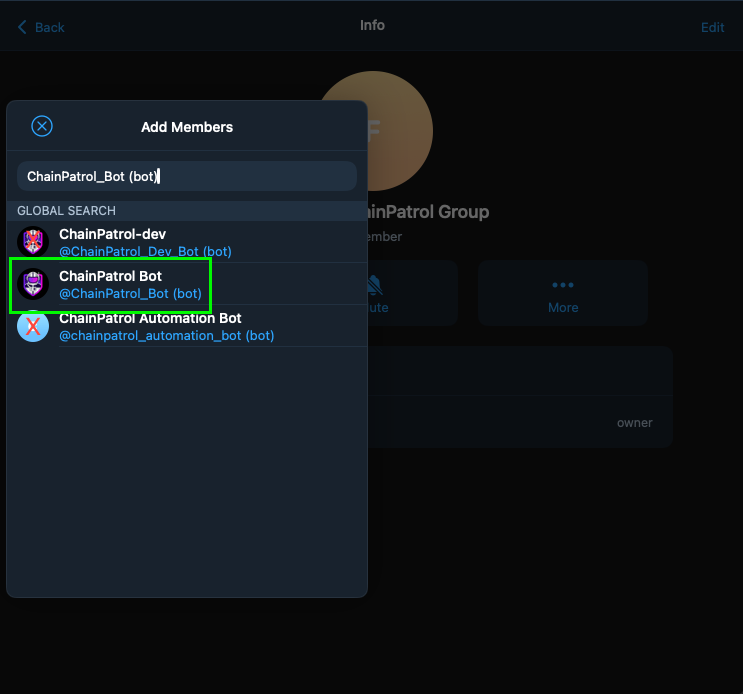
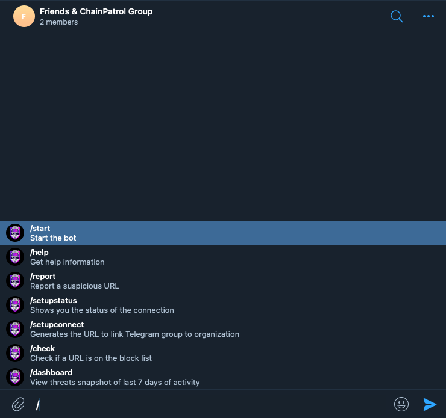
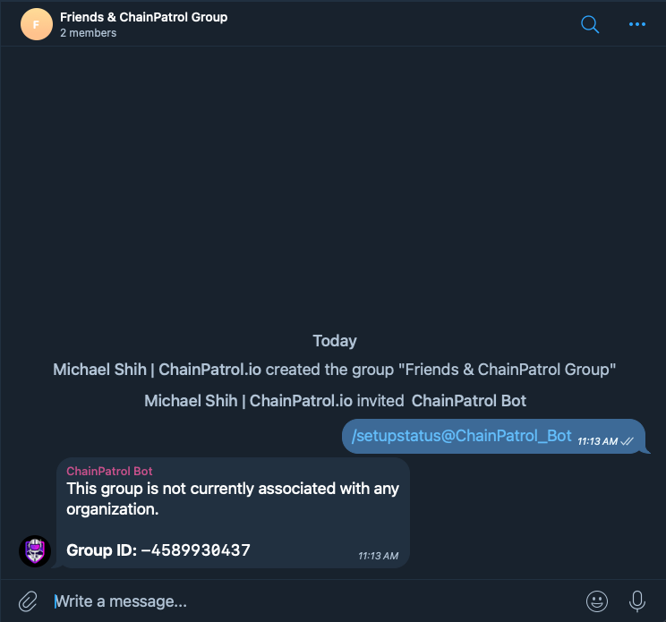
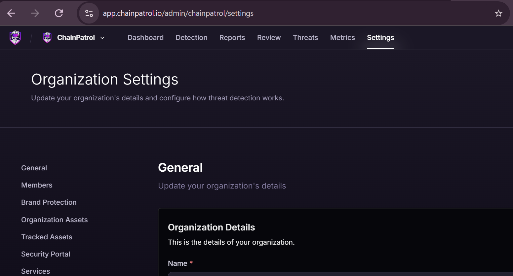
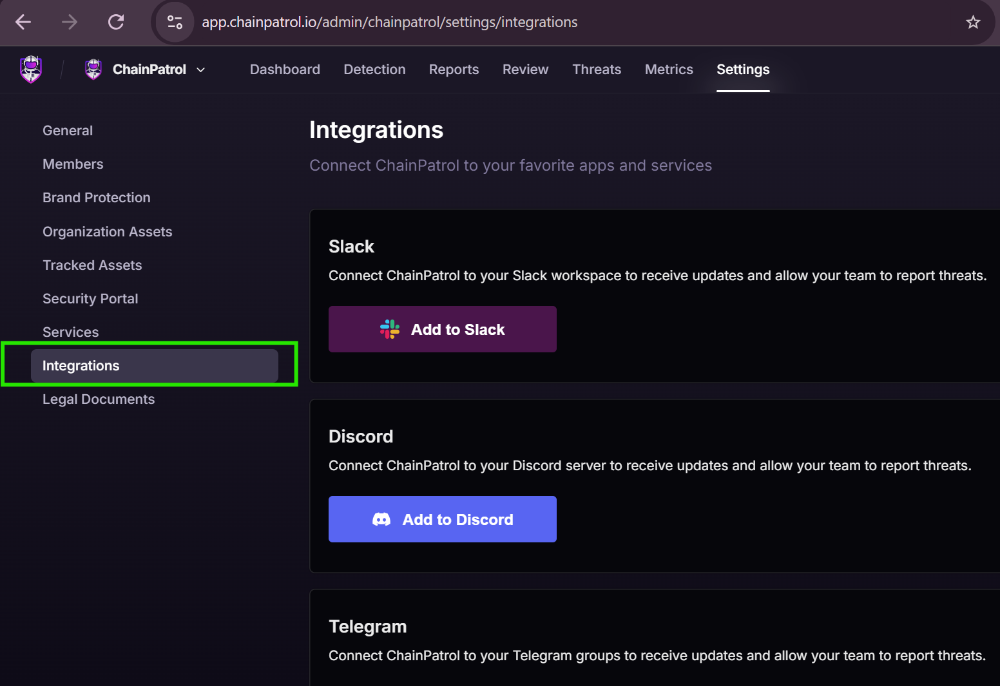
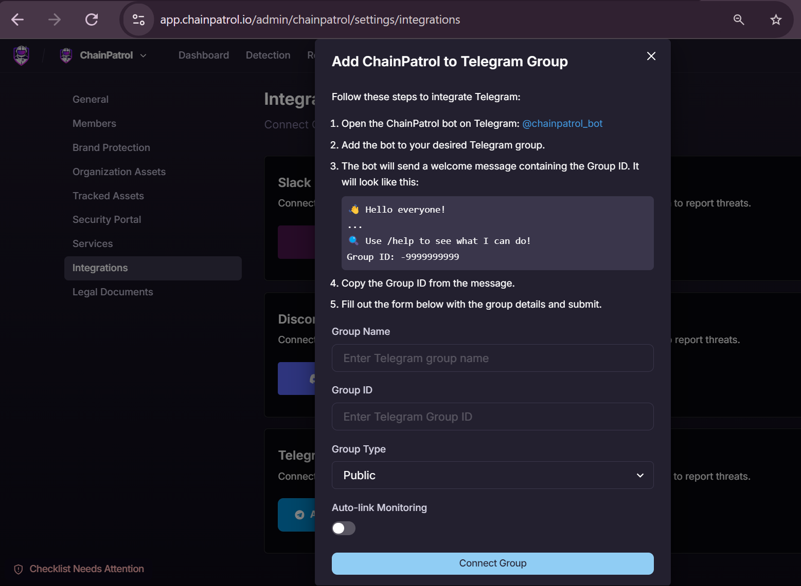
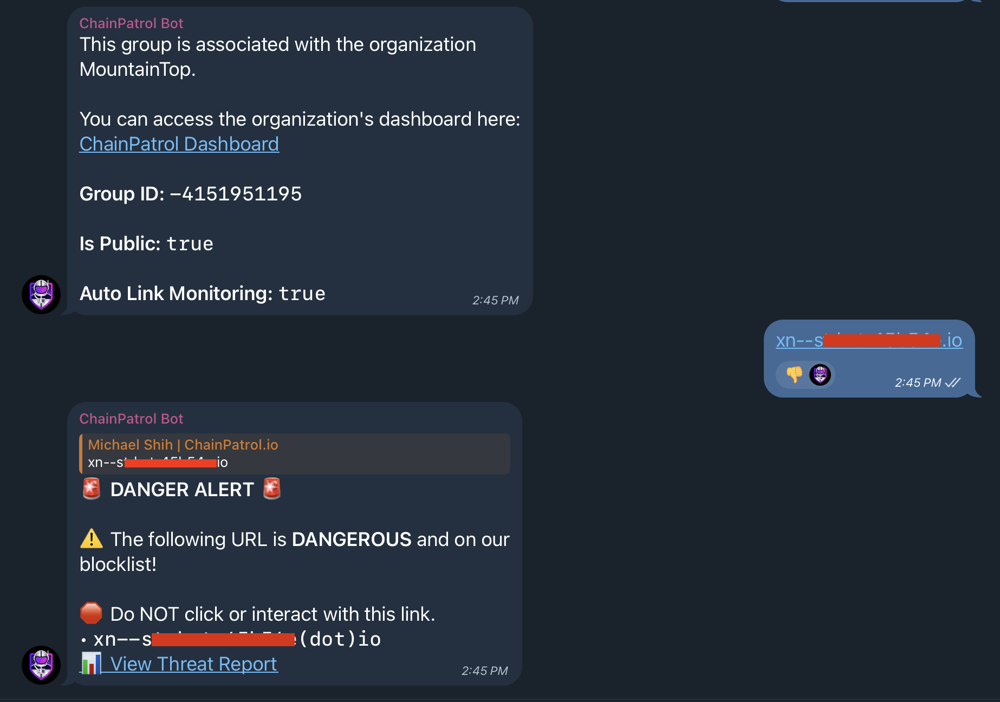

Si tienes un **grupo de Telegram**, puedes usar el bot de Telegram de ChainPatrol para que los miembros de tu grupo envíen reportes de estafas a **ChainPatrol**. El bot generará nuevos reportes que se envían a tu **Dashboard** (panel principal) de administración para su revisión.

## Configuración

### Instalación del bot

<Steps>
  <Step title="Agrega el bot a tu chat grupal">
    <Warning>
      **¡Cuidado con los impostores!** El bot oficial de Telegram de ChainPatrol es `@ChainPatrol_Bot`. Si ves cualquier otro bot que diga ser el bot de ChainPatrol, por favor, repórtanoslo.
    </Warning>
    Empieza por agregar el bot de Telegram de ChainPatrol a tu chat grupal. Puedes encontrar el bot buscando su nombre de usuario en Telegram.

    <Frame></Frame>

  </Step>

  <Step title="Comandos">
    Una vez que el bot esté agregado a tu chat grupal, usa el comando `/help` para ver los comandos disponibles.

    <Frame></Frame>

  </Step>
</Steps>

### Configuración del bot

<Frame></Frame>

<Steps>
  <Step title="Ve a la configuración del bot">

    Visita tu [Dashboard de ChainPatrol](https://app.chainpatrol.io/admin) y ve a la página **Settings** (configuración).

    <Tip>
      Si no tienes una cuenta de ChainPatrol y quieres proteger a tu comunidad, ¡contáctanos directamente!
    </Tip>
    <Frame></Frame>

  </Step>
  <Step title="Ve a Integrations">
    Ve a **Integrations** (integraciones) en la barra lateral izquierda.
    <Frame></Frame>

  </Step>
  <Step title="Agrega los datos del grupo">
    Haz clic en "Add New Telegram Group" y configura los datos del grupo.

    <Frame></Frame>

  </Step>
</Steps>

## Uso

<Tip>

Usa el comando `/setupconnect` para confirmar la conexión entre tu grupo y ChainPatrol.

</Tip>

Una vez que el bot esté agregado a tu grupo y el proceso de conexión esté completo, puedes usar los siguientes comandos:

### Comandos

- `/report <url> <description>` - Envía un reporte de estafa para la URL indicada con una breve descripción de por qué es sospechosa
- `/check <url>` - Comprueba si una URL está en la **Blocklist** (lista de bloqueo)
- `/setupstatus` - Averigua si este chat grupal está asociado a una organización
- `/setupconnect` - Muestra a qué organización está vinculado el grupo, o cómo vincularlo (con el ID del grupo)
- `/help` - Muestra una lista de los comandos disponibles y sus descripciones

## Funciones

### Monitoreo automático de enlaces

El bot de Telegram de ChainPatrol monitorea automáticamente todos los enlaces que se comparten en tu chat grupal. Esta función ofrece una capa adicional de protección para tu comunidad:

- **Escaneo en tiempo real**: Cada enlace publicado en el grupo se comprueba al instante contra la amplia base de datos de ChainPatrol de estafas y URLs maliciosas conocidas.
- **Alertas automáticas**: Si se detecta un enlace potencialmente dañino, el bot notifica de inmediato al grupo y advierte a los miembros sobre el posible riesgo.
- **Protección proactiva**: Esta función ayuda a prevenir las estafas antes de que puedan afectar a los miembros de tu comunidad, incluso si ningún moderador está monitoreando activamente el grupo.

<Frame>
  
</Frame>

## Privacidad

El bot no recopila ninguna información personal. Solo recopila la URL y el ID de Telegram del usuario que envió el reporte (por si un moderador necesita más información sobre por qué la URL es una estafa). El bot no almacena ninguna información sensible sobre el grupo al que se agrega.

<Tip>

El bot de Telegram de ChainPatrol es como cualquier usuario del grupo. Puedes ajustar los permisos
según las necesidades de tu grupo.

</Tip>
