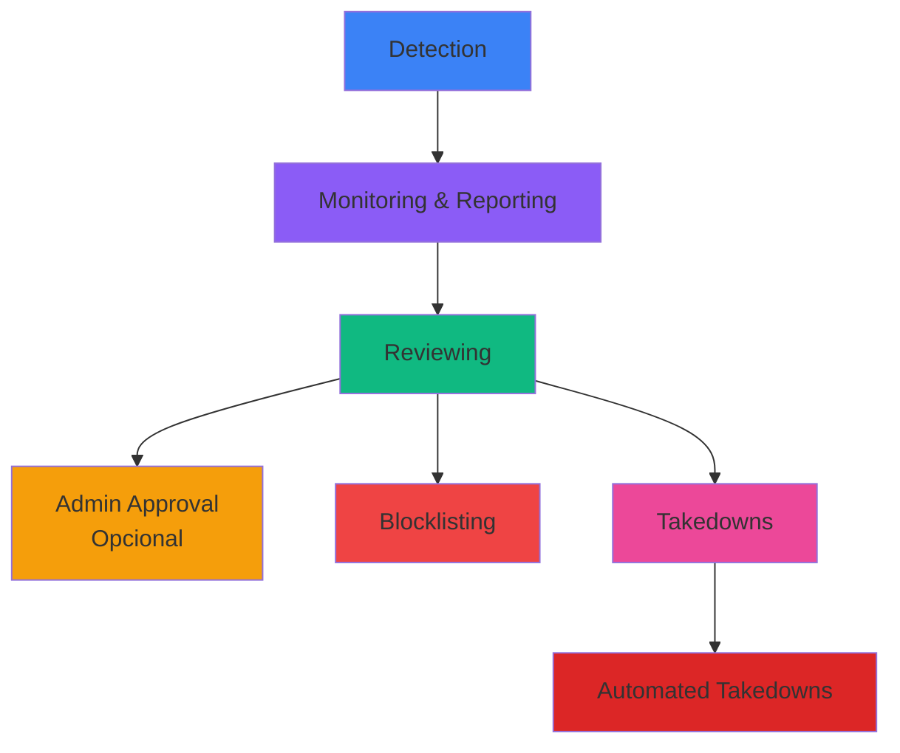

ChainPatrol ofrece múltiples servicios de seguridad que se pueden configurar según las necesidades de tu organización. La mayoría de los servicios se puede activar de forma independiente. **Takedowns** (solicitudes de baja de contenido fraudulento) solo se puede activar una vez que **Blocklisting** (inclusión de amenazas en la **Blocklist**, la lista de bloqueo) está activado. Blocklisting y Takedowns, y sus versiones automatizadas, también necesitan la aprobación de un propietario de la organización (**Organization Owner**) cuando los activa alguien que no es propietario.

<Info>
**Dónde encontrar Services:** Ve a la configuración de tu organización → Services
</Info>

## Servicios disponibles

<CardGroup cols={3}>
  <Card title="Detection" icon="magnifying-glass" color="#3b82f6">
    Escaneo automatizado en busca de amenazas
  </Card>
  
  <Card title="Monitoring & Reporting" icon="eye" color="#8b5cf6">
    Inteligencia de amenazas continua
  </Card>
  
  <Card title="Reviewing" icon="clipboard-check" color="#10b981">
    Validación de amenazas por expertos
  </Card>
  
  <Card title="Admin Approval" icon="user-shield" color="#f59e0b">
    Flujo de aprobación interno
  </Card>
  
  <Card title="Blocklisting" icon="ban" color="#ef4444">
    Distribución de la Blocklist en tiempo real a navegadores, wallets y plataformas aliadas
  </Card>
  
  <Card title="Takedowns" icon="power-off" color="#ec4899">
    Eliminación profesional de amenazas
  </Card>
  
  <Card title="Automated Takedowns" icon="bolt" color="#dc2626">
    Envío instantáneo de takedowns
  </Card>
  
  <Card title="Dark Web Monitoring" icon="user-secret" color="#6366f1">
    Exposición de tus marcas en la dark web
  </Card>
</CardGroup>

## Detection

<Tabs>
  <Tab title="Qué hace" icon="info">
    El servicio **Detection** (detección) escanea automáticamente diversas fuentes de internet para identificar **assets** (activos digitales: URLs, direcciones, perfiles, apps, etc.) potencialmente maliciosos dirigidos a tu marca u organización. Esto incluye el monitoreo de registros de dominios, plataformas de redes sociales y otros canales donde suelen aparecer las amenazas.
  </Tab>
  
  <Tab title="Quién lo necesita" icon="users">
    **Ideal para:**
    - Organizaciones que quieren un monitoreo proactivo de la suplantación de marca
    - Equipos que buscan identificar las amenazas antes de que lleguen a los usuarios finales
    - Empresas con una presencia en línea significativa, susceptible a ataques de phishing
  </Tab>
  
  <Tab title="Cuándo habilitarlo" icon="calendar">
    **Requisitos previos:**
    - Completa el perfil de tu organización
    - Define tus tracked assets (los assets a los que se les da seguimiento: dominios, usuarios de redes sociales, identificadores de marca)
    - Asegúrate de que tu equipo esté listo para recibir alertas sobre amenazas sospechosas
  </Tab>
  
  <Tab title="Requisitos" icon="list-check">
    **Aprobaciones requeridas:**
    - Ninguna: cualquier persona que pueda administrar servicios puede activarlo directamente
    - Revisión del equipo de ChainPatrol para la configuración inicial
    
    **Documentos legales requeridos:**
    - Ninguno
  </Tab>
</Tabs>

---

## Monitoring & Reporting

<Tabs>
  <Tab title="Qué hace" icon="info">
    Este servicio (**Monitoring & Reporting**, monitoreo y reporte) monitorea la web continuamente en busca de nuevas amenazas para tu marca, incluidos sitios de phishing, estafas e intentos de suplantación. Cuando se detectan posibles amenazas, se reportan automáticamente al sistema de revisión de ChainPatrol para su validación y para tomar acción.
  </Tab>
  
  <Tab title="Quién lo necesita" icon="users">
    **Ideal para:**
    - Organizaciones que requieren una protección de marca integral
    - Equipos de seguridad que necesitan inteligencia de amenazas continua
    - Empresas que quieren adelantarse a las estafas y campañas de phishing emergentes
  </Tab>
  
  <Tab title="Cuándo habilitarlo" icon="calendar">
    **Requisitos previos:**
    - Habilita primero el servicio Detection
    - Cuenta con recursos dedicados para atender las notificaciones de amenazas
    - Establece el flujo de respuesta a amenazas de tu organización
  </Tab>
  
  <Tab title="Requisitos" icon="list-check">
    **Aprobaciones requeridas:**
    - Ninguna: cualquier persona que pueda administrar servicios puede activarlo directamente
    
    **Documentos legales requeridos:**
    - Ninguno
  </Tab>
</Tabs>

---

## Reviewing

<Tabs>
  <Tab title="Qué hace" icon="info">
    El servicio **Reviewing** (revisión) garantiza que los expertos en seguridad de ChainPatrol revisen manualmente todas las amenazas sospechosas de tu organización. Esto agrega una capa de validación humana para confirmar que las amenazas son reales y no falsos positivos.
  </Tab>
  
  <Tab title="Quién lo necesita" icon="users">
    **Ideal para:**
    - Organizaciones que priorizan la precisión sobre la velocidad
    - Empresas preocupadas por los falsos positivos
    - Equipos nuevos en la detección de amenazas que quieren validación de expertos
  </Tab>
  
  <Tab title="Cuándo habilitarlo" icon="calendar">
    **Requisitos previos:**
    - Se puede habilitar de inmediato, junto con los servicios Detection y Monitoring
    - Habilítalo cuando quieras que los expertos de ChainPatrol validen todas las amenazas antes de actuar
  </Tab>
  
  <Tab title="Requisitos" icon="list-check">
    **Aprobaciones requeridas:**
    - Ninguna: cualquier persona que pueda administrar servicios puede activarlo directamente
    
    **Documentos legales requeridos:**
    - Ninguno
  </Tab>
</Tabs>

---

## Obligatory Organization Admin Approval

<Tabs>
  <Tab title="Qué hace" icon="info">
    Este servicio (**Obligatory Organization Admin Approval**, aprobación obligatoria de un administrador de la organización) requiere que los administradores de tu organización revisen y aprueben todas las amenazas validadas por el equipo de ChainPatrol antes de que se agreguen a la Blocklist de tu organización. Puedes configurar qué tipos de assets (redes sociales, dominios, wallets, etc.) requieren esta aprobación.
  </Tab>
  
  <Tab title="Quién lo necesita" icon="users">
    **Ideal para:**
    - Organizaciones con requisitos estrictos de cumplimiento interno
    - Empresas que quieren la supervisión final de todo el contenido bloqueado
    - Equipos con regulaciones específicas de su industria que exigen aprobación manual
    - Organizaciones que prefieren tener control sobre lo que se bloquea
  </Tab>
  
  <Tab title="Cuándo habilitarlo" icon="calendar">
    **Requisitos previos:**
    - Habilítalo después del servicio Reviewing
    - Cuenta con administradores designados disponibles para revisar las **Proposals** (propuestas para bloquear o permitir un asset) con regularidad
    - Habilítalo antes de Blocklisting si quieres tener control de aprobación
  </Tab>
  
  <Tab title="Requisitos" icon="list-check">
    **Aprobaciones requeridas:**
    - Ninguna (los administradores de la organización pueden configurarlo directamente)
    
    **Documentos legales requeridos:**
    - Ninguno
  </Tab>
  
  <Tab title="Configuración" icon="gear">
    **Opciones de configuración:**
    - Habilitar o deshabilitar el requisito de aprobación
    - Seleccionar los tipos de asset específicos que requieren aprobación:
      - Dominios
      - Cuentas de redes sociales
      - Apps de mensajería
      - Direcciones cripto
      - Y más
    
    <Note>
    Si no se selecciona ningún tipo específico, todos los tipos de asset requerirán aprobación
    </Note>
  </Tab>
</Tabs>

---

## Blocklisting

<Tabs>
  <Tab title="Qué hace" icon="info">
    Las amenazas aprobadas se agregan a la Blocklist global de ChainPatrol, que se distribuye en tiempo real a navegadores, proveedores de DNS y plataformas de seguridad aliados (incluidos Google Safe Browsing, Quad9 y VirusTotal), además de wallets cripto como Coinbase Wallet y MetaMask. Esto evita que los usuarios interactúen con dominios, direcciones o contratos maliciosos antes de que sufran algún daño.
  </Tab>
  
  <Tab title="Quién lo necesita" icon="users">
    **Ideal para:**
    - Cualquier marca de fintech, banca, cripto, iGaming, capital de riesgo (VC) y más que quiera que sus amenazas confirmadas se bloqueen automáticamente en navegadores, resolvedores de DNS y herramientas antivirus
    - Organizaciones cuyos usuarios también interactúan con wallets cripto o productos conectados a blockchain
    - Proyectos de criptomonedas, protocolos, plataformas DeFi y proyectos de NFT
  </Tab>
  
  <Tab title="Cuándo habilitarlo" icon="calendar">
    **Requisitos previos:**
    <Steps>
      <Step title="Completa el perfil de la organización">
        Asegúrate de que todos los datos de la organización sean correctos
      </Step>
      
      <Step title="Configura los tracked assets">
        Configura todos los assets que quieres proteger
      </Step>
      
      <Step title="Habilita los servicios base">
        Detection, Monitoring y Reviewing deben estar activos
      </Step>
      
      <Step title="Verifica la configuración">
        Confirma que los assets de la organización y los escaneos de tracked assets sean correctos
      </Step>
    </Steps>
  </Tab>
  
  <Tab title="Requisitos" icon="list-check">
    **Aprobaciones requeridas:**
    - Aprobación del propietario de la organización (obligatoria)
    - Confirmación de que los assets de la organización y los tracked assets están configurados correctamente
    
    **Documentos legales requeridos:**
    - Ninguno
    
    <Warning>
    **Importante:** Habilitar Blocklisting tiene un impacto inmediato en los usuarios finales. Las organizaciones deben verificar que la configuración de sus assets sea correcta antes de habilitar este servicio.
    </Warning>
  </Tab>
</Tabs>

---

## Takedowns

<Tabs>
  <Tab title="Qué hace" icon="info">
    Para las amenazas aprobadas, ChainPatrol envía en tu nombre solicitudes profesionales de takedown a proveedores de hosting, registradores de dominios y administradores de plataformas. Nuestro equipo se encarga de todo el proceso de takedown, incluidos los seguimientos y la documentación.
  </Tab>
  
  <Tab title="Quién lo necesita" icon="users">
    **Ideal para:**
    - Organizaciones que quieren la eliminación activa de amenazas, no solo su detección
    - Empresas que no cuentan con experiencia interna para presentar solicitudes de takedown
    - Equipos que necesitan hacer valer la protección de su propiedad intelectual y de sus marcas registradas
    - Marcas que enfrentan grandes volúmenes de suplantación o phishing
  </Tab>
  
  <Tab title="Cuándo habilitarlo" icon="calendar">
    **Requisitos previos:**
    - Activa primero Blocklisting. Takedowns no se puede activar sin él, porque sin Blocklisting las amenazas confirmadas quedan pendientes y no se presenta ningún takedown
    - Verifica que tu organización tenga políticas adecuadas de protección de marca
    - Prepárate para que ChainPatrol represente a tu organización en las comunicaciones de takedown
  </Tab>
  
  <Tab title="Requisitos" icon="list-check">
    **Aprobaciones requeridas:**
    - Aprobación del propietario de la organización (si lo solicita un miembro)
    - Revisión legal de ChainPatrol
    
    **Documentos legales requeridos:**
    - Prueba de titularidad de la marca registrada o de la marca
    - Información de contacto de la organización
    - Datos del representante autorizado
  </Tab>
</Tabs>

---

## Automated Takedowns

<Tabs>
  <Tab title="Qué hace" icon="info">
    Las solicitudes de takedown se envían automáticamente a los proveedores de hosting inmediatamente después de que el equipo de ChainPatrol (y tu organización, si Obligatory Organization Admin Approval está habilitado) aprueba una amenaza. Esto ofrece el tiempo de respuesta más rápido posible para la eliminación de amenazas.
  </Tab>
  
  <Tab title="Quién lo necesita" icon="users">
    **Ideal para:**
    - Organizaciones que enfrentan grandes volúmenes de amenazas que requieren una respuesta rápida
    - Empresas con procesos maduros de detección de amenazas
    - Equipos que confían plenamente en el proceso de revisión de ChainPatrol
    - Marcas de industrias de alto riesgo (fintech, banca, iGaming, cripto, comercio electrónico)
  </Tab>
  
  <Tab title="Cuándo habilitarlo" icon="calendar">
    **Requisitos previos:**
    <Steps>
      <Step title="Habilita todos los demás servicios">
        Todos los servicios deben estar habilitados y funcionando correctamente
      </Step>
      
      <Step title="Sube la Letter of Authorization">
        Se debe subir un documento de LOA (carta de autorización) válido
      </Step>
      
      <Step title="Configura la URL del sitio web">
        Se debe definir la URL del sitio web principal de la organización
      </Step>
      
      <Step title="Valida la detección">
        Ten confianza en la precisión de tu detección de amenazas
      </Step>
    </Steps>
  </Tab>
  
  <Tab title="Requisitos" icon="list-check">
    **Aprobaciones requeridas:**
    - Aprobación del propietario de la organización (obligatoria)
    - Aprobación del equipo legal de ChainPatrol
    
    **Documentos legales requeridos:**
    - **Letter of Authorization (LOA)** - Autoriza a ChainPatrol a enviar solicitudes de takedown en tu nombre
    - URL del sitio web principal de tu organización
    - Documentos de registro de marca
    - Información del firmante autorizado
    
    <Warning>
    **Importante:** Automated Takedowns no se puede habilitar sin estos requisitos previos. El servicio permanecerá deshabilitado hasta que se proporcionen tanto la LOA como la URL del sitio web.
    </Warning>
  </Tab>
</Tabs>

---

## Proceso de aprobación

### Flujo de solicitud para habilitar un servicio

<Steps>
  <Step title="Envío de la solicitud">
    **Miembros de la organización y staff:**
    - Envían una solicitud para habilitar el servicio
    - Los propietarios de la organización reciben una notificación por correo
    - La solicitud aparece como "Pending" (pendiente) en la página Services
    - Ningún cambio entra en vigor hasta que se aprueba
  </Step>
  
  <Step title="Aprobación del propietario">
    **Propietarios de la organización:**
    - Pueden habilitar servicios de inmediato, sin aprobación
    - Pueden aprobar las solicitudes pendientes de los miembros del equipo
    - Reciben notificaciones por correo de todas las solicitudes de cambio de servicios
  </Step>
  
  <Step title="Revisión de ChainPatrol">
    **Para ciertos servicios:**
    - Algunos servicios requieren la verificación del equipo de ChainPatrol
    - El equipo legal revisa la documentación para Takedowns y Automated Takedowns
    - El equipo de seguridad valida la configuración para Blocklisting
  </Step>
</Steps>

### Cómo deshabilitar servicios

<CardGroup cols={2}>
  <Card title="Acciones del propietario" icon="user-shield">
    Los propietarios de la organización pueden deshabilitar cualquier servicio en cualquier momento
  </Card>
  
  <Card title="Miembros" icon="users">
    Los miembros con el permiso OrganizationServices:update también pueden deshabilitar servicios. Desactivar un servicio nunca requiere aprobación
  </Card>
  
  <Card title="Efecto inmediato" icon="bolt">
    Deshabilitar un servicio tiene efecto inmediato, sin importar quién lo desactive
  </Card>
  
  <Card title="Conservación de datos" icon="database">
    Los datos y el historial del servicio se conservan cuando se deshabilita
  </Card>
</CardGroup>

---

## Requisitos legales

### Documentación requerida por servicio

| Servicio | Documentos requeridos | Cuándo se necesitan |
|---------|-------------------|-------------|
| Detection | Ninguno | - |
| Monitoring & Reporting | Ninguno | - |
| Reviewing | Ninguno | - |
| Obligatory Organization Admin Approval | Ninguno | - |
| Blocklisting | Ninguno (pero se requiere verificación) | - |
| Takedowns | Prueba de marca registrada, datos del representante autorizado | Antes de habilitarlo |
| Automated Takedowns | Letter of Authorization, registro de marca, URL del sitio web principal | Antes de habilitarlo |
| Dark Web Monitoring | Ninguno | - |

### Requisitos de la Letter of Authorization

Para Automated Takedowns, tu Letter of Authorization debe:

<AccordionGroup>
  <Accordion title="Alcance de la autorización" icon="scale-balanced">
    Autorizar específicamente a ChainPatrol a enviar solicitudes de takedown en nombre de tu organización
  </Accordion>
  
  <Accordion title="Requisitos de firma" icon="signature">
    Estar firmada por un representante autorizado de tu organización
  </Accordion>
  
  <Accordion title="Datos de la organización" icon="building">
    Incluir la razón social y la información de contacto de tu organización
  </Accordion>
  
  <Accordion title="Período de validez" icon="calendar">
    Tener una fecha dentro de los últimos 12 meses (recomendado)
  </Accordion>
  
  <Accordion title="Formato del archivo" icon="file-pdf">
    Subirse en formato PDF a la configuración de tu organización
  </Accordion>
</AccordionGroup>

<Tip>
**Cómo subirla:** Ve a **Settings → Legal Documents** (configuración → documentos legales) y haz clic en **Upload**
</Tip>

### Documentación de marca registrada

Tanto para Takedowns como para Automated Takedowns:

<CardGroup cols={2}>
  <Card title="Números de registro" icon="hashtag">
    Proporciona los números de registro de marca o las solicitudes en trámite
  </Card>
  
  <Card title="Jurisdicciones" icon="globe">
    Incluye las jurisdicciones donde están registradas las marcas
  </Card>
  
  <Card title="Prueba de titularidad" icon="certificate">
    Demuestra la titularidad clara de los assets de marca
  </Card>
  
  <Card title="Uso comercial" icon="store">
    Proporciona evidencia de uso legítimo en el comercio
  </Card>
</CardGroup>

---

## Dependencias entre servicios

---

<Card
  title="Configura tus servicios"
  icon="gear"
  href="https://app.chainpatrol.io"
>
  Inicia sesión en tu **Dashboard** (panel principal) para habilitar y configurar los servicios de tu organización
</Card>
