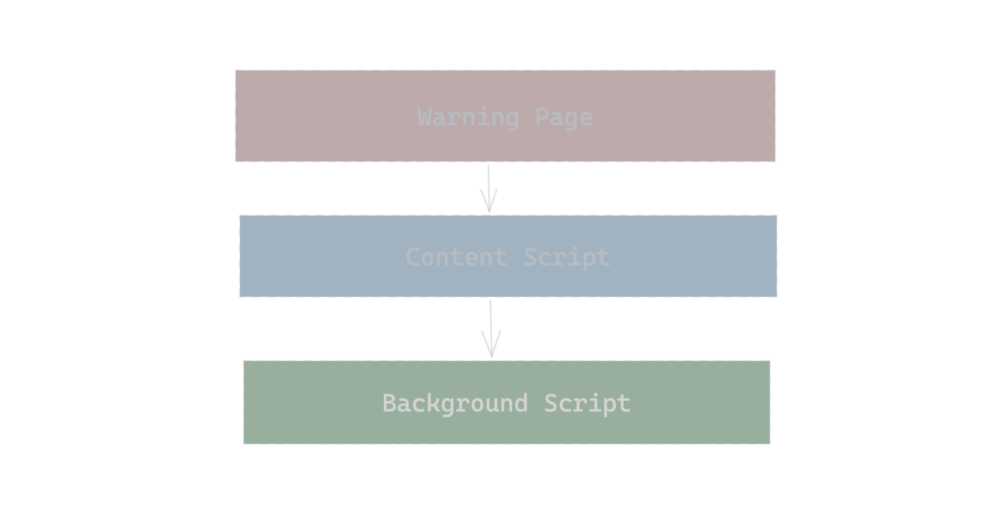

La clase `Relay` es una utilidad para recibir mensajes de la página de advertencia
de ChainPatrol en tu wallet o app de seguridad basada en una extensión de navegador. Es posible
que ya tengas un sistema de paso de mensajes en tu extensión de navegador, pero
esta clase se ofrece para facilitarles el trabajo a quienes no lo tienen, o por si quieres
mantener tu sistema de paso de mensajes separado del SDK de ChainPatrol.

## Uso

<CodeGroup>

```js Warning Page
import { Relay, Events } from "@chainpatrol/sdk";

// Send a message to the extension
Relay.send(Events.ContinueAtOwnRisk, { domain: "example.com" });
```

```js Content Script
import { Relay, Events } from "@chainpatrol/sdk";

Relay.run([Events.ContinueAtOwnRisk]);
```

```js Background Script
import { Relay, Events } from "@chainpatrol/sdk";

// Listen for messages from relay
Relay.on(Events.ContinueAtOwnRisk, (data) => {
  // Do something with the event data
});
```

</CodeGroup>

## Cómo funciona

Para que tu extensión de navegador reciba los eventos de la página de advertencia,
los mensajes tienen que retransmitirse desde la página de advertencia al script de contenido, y luego
desde el script de contenido al script en segundo plano.

<Frame>
  
</Frame>

Internamente, la clase `Relay` configura los listeners de mensajes adecuados según
el contexto de ejecución del script (es decir, `window.postMessage` en la página de advertencia, `chrome.runtime.sendMessage` en los scripts de contenido
y en segundo plano), y se asegura de que todos los mensajes lleguen a todos los
suscriptores.

---

## Métodos estáticos

### [send()](./static-methods/send)

Envía un evento a los listeners.

### [run()](./static-methods/run)

Configura listeners para los eventos y reenvía los eventos a todos los demás listeners.

### [on()](./static-methods/on)

Agrega un listener para un evento.
