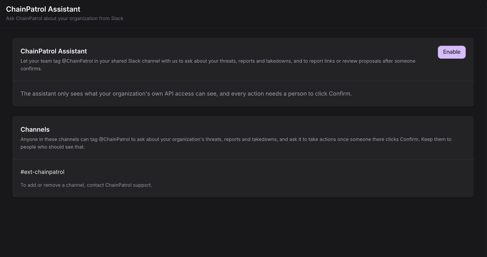
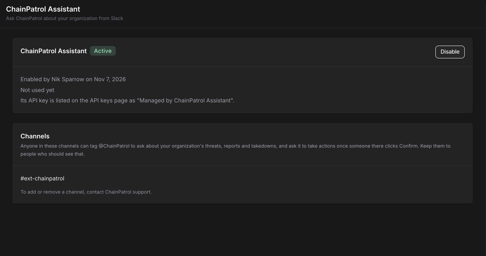

The ChainPatrol Assistant answers questions about your organization right inside Slack. Tag `@ChainPatrol` in your shared Slack channel with ChainPatrol and ask things like "what did we take down this week?" or "is this link blocked?". It can also report links, review proposals and file disputes, but only after someone in the channel clicks **Confirm**.

<Info>
  The ChainPatrol Assistant is available to selected customers. To get access,
  contact your ChainPatrol representative or
  [support@chainpatrol.io](mailto:support@chainpatrol.io).
</Info>

## Before you start

- Your Slack workspace is connected to ChainPatrol. See the [Slack integration](/integration/slack).
- You have a shared Slack channel (Slack Connect) with ChainPatrol. This is where the assistant answers.
- You are an **Owner** or **Admin** of your ChainPatrol organization. Other members can see the settings page, but can't turn the assistant on or off.

## Turn it on

<Steps>
  <Step title="Open the ChainPatrol Assistant settings">
    In the [ChainPatrol app](https://app.chainpatrol.io/), go to **Settings** and select **ChainPatrol Assistant** in the sidebar.

    <Frame></Frame>

  </Step>
  <Step title="Click Enable">
    Click **Enable**. The status changes to **Active**, and the page shows who turned it on and when.

    <Frame></Frame>

  </Step>
  <Step title="Ask ChainPatrol to add your channel">
    The assistant only answers in channels that ChainPatrol has added for your organization. Contact ChainPatrol support to add your shared channel. Once it is added, it appears under **Channels** on the same page.

    When a channel is added, the assistant posts and pins a short welcome message there, so everyone in the channel knows it is available.

  </Step>
</Steps>

When you turn the assistant on, ChainPatrol creates an API key just for it. That key can see and do only what your organization's own API access can. It is listed on your **API keys** page as "Managed by ChainPatrol Assistant". Nobody, including you, ever sees the key itself.

<Warning>
  Anyone in a listed channel can ask the assistant about your organization and
  click Confirm on its actions. Keep these channels to people who should see
  your ChainPatrol data.
</Warning>

## Ask a question

Tag `@ChainPatrol` with your question. The assistant first replies "Looking into it…" in a thread, then replaces that message with its answer.

- **Follow-ups:** reply in the same thread and tag `@ChainPatrol` again. It reads the earlier messages in the thread, including its own answers, so you don't need to repeat yourself.
- **Screenshots:** you can attach a screenshot of a suspicious site or message. The assistant reads the links, accounts, wallet addresses and other details shown in the four most recent images in the thread.
- **Report links:** paste a link to a ChainPatrol report and it tells you, for each asset, how it was reviewed, whether it is blocked, whether it is still live, and how its takedown is going.

The assistant reads only the thread you tagged it in. It does not read the rest of the channel or anything else in your Slack workspace.

### What you can ask about

<CardGroup cols={2}>
  <Card title="Assets" icon="magnifying-glass">
    Whether a link, account or address is blocked, allowed or has been reported.
  </Card>
  <Card title="Reports and threats" icon="flag">
    Your reports, threats, watchlist, and proposals waiting for your review.
  </Card>
  <Card title="Takedowns" icon="gavel">
    Takedowns in progress and completed, and how long they took.
  </Card>
  <Card title="Metrics" icon="chart-line">
    Threats found, where they were found, takedown success rate and time to takedown.
  </Card>
  <Card title="Your setup" icon="gear">
    Your brands, allowlist, asset groups and detection settings.
  </Card>
  <Card title="How ChainPatrol works" icon="book">
    Questions about the dashboard, integrations and API, answered from these docs, with a link to the page it used.
  </Card>
</CardGroup>

It answers only from your organization's ChainPatrol data and these docs. It doesn't make up numbers, and it can't answer questions about other organizations.

## Actions and Confirm

The assistant can take three actions:

| Action | What it does |
| --- | --- |
| **Report** | Reports up to 10 links, accounts or addresses to ChainPatrol. It won't report a whole well-known site, such as a major social network. |
| **Review a proposal** | Approves (blocks), rejects, or rejects and watchlists a proposal waiting for your review. A review can't be undone. |
| **Dispute** | Disputes a ChainPatrol decision about a link, account or address. Replies to the dispute go to the admin who turned the assistant on. |

Ask in plain words, for example "@ChainPatrol please report this link". The assistant never acts on its own. It posts a card in the thread that shows exactly what will be sent, with **Confirm** and **Cancel** buttons.

- Nothing happens until someone in the channel clicks **Confirm**.
- The card expires after **15 minutes**. After that, ask again.
- Only one click counts. Once someone confirms or cancels, the card shows who did it and what happened.

Reports, reviews and disputes sent this way include the note "Sent through the ChainPatrol Assistant in Slack" with the Slack names of the person who asked and the person who confirmed.

## Talk to a human

Ask the assistant to talk to someone, or tell it something is urgent. It passes your message to the ChainPatrol team, and a team member replies in the same Slack thread. If you want a call, it shares a link to book one with our customer success team.

## Limits

- **Where it works:** only in channels ChainPatrol has added for your organization. It doesn't answer in direct messages. In any other channel, only you see a reply saying it isn't turned on there.
- **How often:** each person can ask up to 10 questions in a row, then about one more a minute. Past that, the assistant asks you to wait a bit and try again.
- **Proposal reviews:** together with reviews made through the API, up to 10 proposal reviews per organization per day. Reviews on the **Review** page in the dashboard don't count toward this.
- **Talk to a human:** up to 10 requests per organization per hour.

## Turn it off

Go to **Settings → ChainPatrol Assistant** and click **Disable**, then confirm. The assistant stops answering at once, and its API key is revoked. You can turn it on again later, and it gets a new key.

If the page shows **Needs attention**, the assistant's API key was revoked (for example, from the API keys page). Click **Re-enable** to give it a new key. If it shows **Paused**, ChainPatrol has paused the assistant for your organization. Contact support with any questions.

## Privacy

- The assistant only sees what your organization's own API access can see. It can't look up other organizations.
- Answers are written by an AI model. ChainPatrol sends it the thread you tagged it in and the data it looks up for your question. See [How we use AI](/getting-started/how-it-works/how-we-use-ai).
- Your conversations with the assistant are not used to train AI models, either ChainPatrol's or the AI provider's. ChainPatrol doesn't store the conversation itself; it keeps only the record of confirmed actions described below.
- For every action someone confirms, ChainPatrol keeps a record of what was sent, the result, the channel and thread, and the Slack names and IDs of the person who asked and the person who confirmed. Cancelled and expired cards are not recorded.
- Links in its answers are written in a safe form (for example `hxxps[://]example[.]com`), so nobody opens a phishing site by accident.
