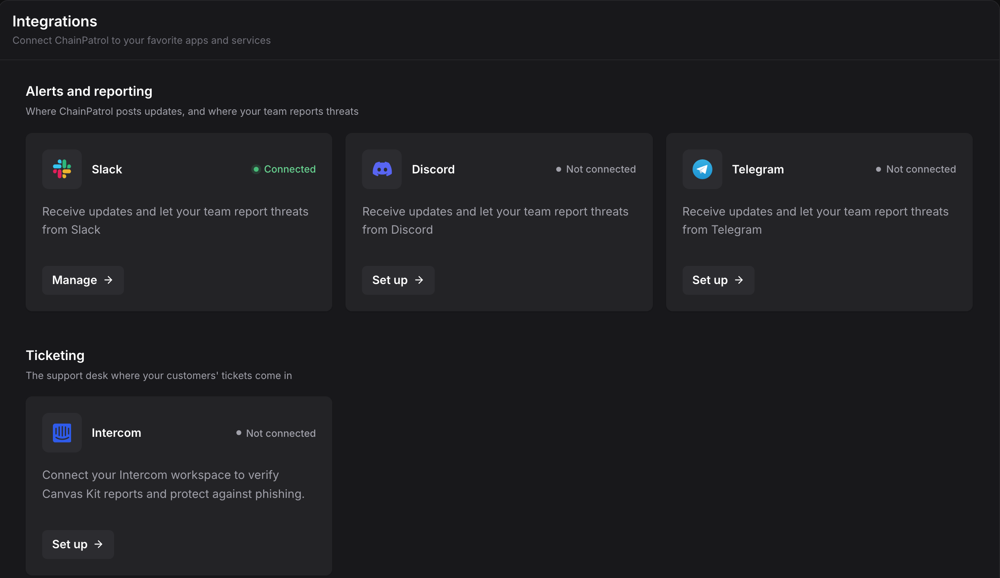
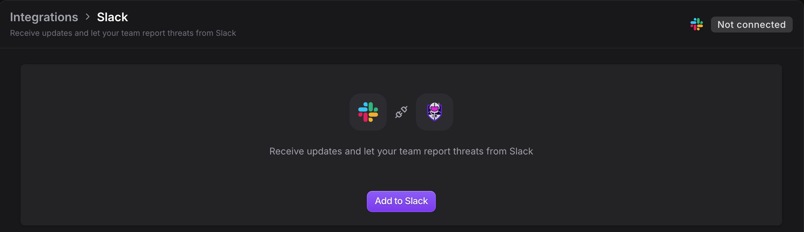
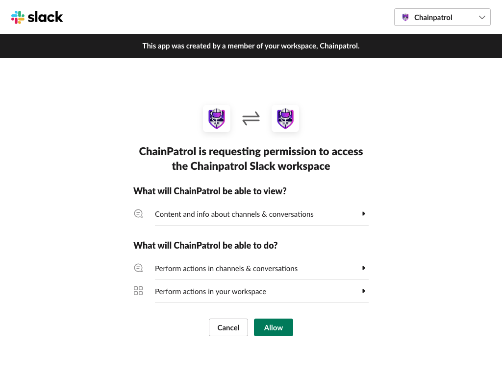
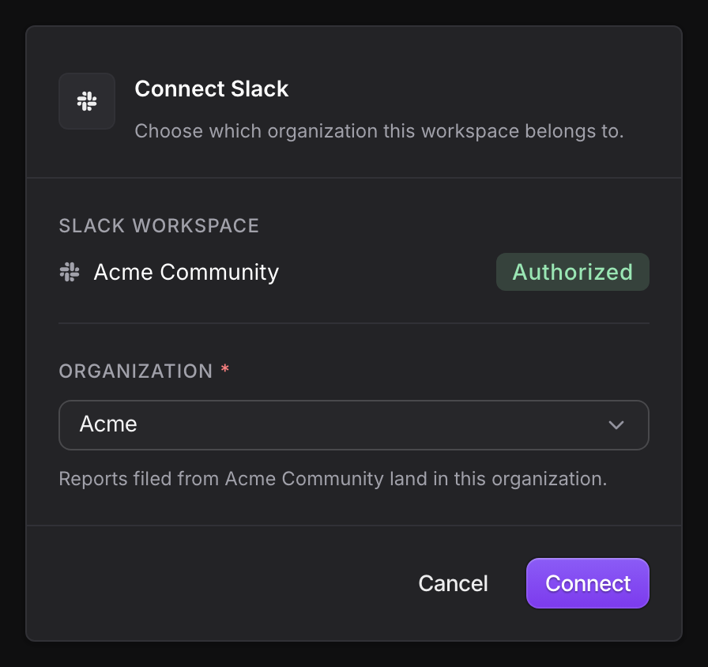
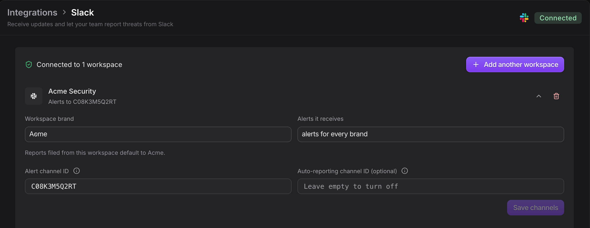
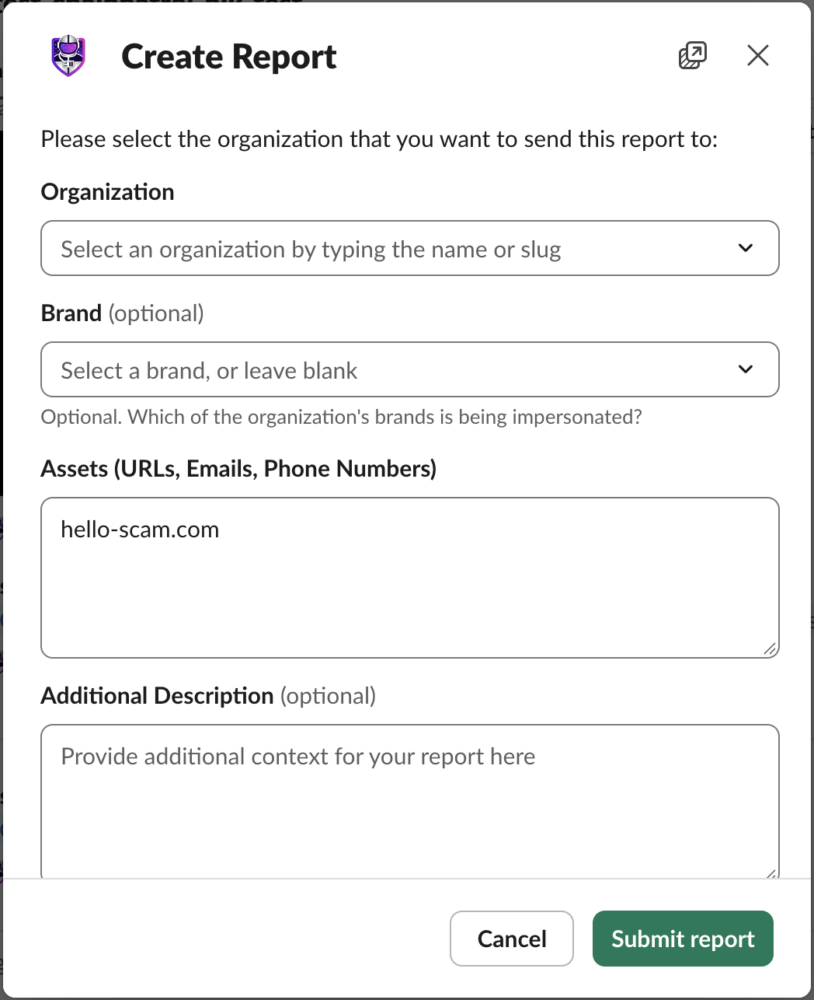
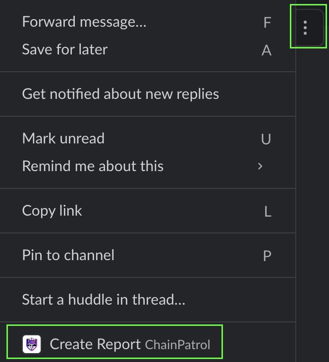
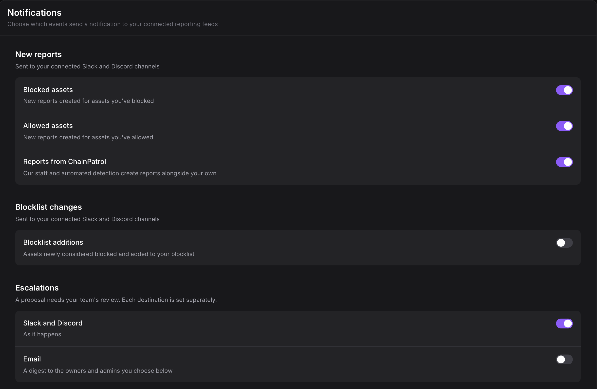

The ChainPatrol Slack bot connects your Slack workspace to your ChainPatrol organization. With it, your team can:

- **Report threats from Slack**: links, emails and phone numbers, with a slash command or from any message.
- **Get alerts in a channel**: new reports, blocklist additions and proposals that need your review.
- **Ask the ChainPatrol Assistant**: tag `@ChainPatrol` in your shared channel with ChainPatrol to ask about your threats and takedowns. See [ChainPatrol Assistant](/integration/chainpatrol-assistant).

## Setup

You need to be an **Owner** or **Admin** of your ChainPatrol organization, and allowed to install apps in your Slack workspace.

<Steps>
  <Step title="Open the Slack integration">
    In the [ChainPatrol app](https://app.chainpatrol.io/), go to **Settings → Integrations** and select the **Slack** tile.

    <Frame></Frame>

  </Step>
  <Step title="Click Add to Slack">
    Click **Add to Slack**. Slack opens its permission screen. Check that the workspace at the top right is the one you want, then click **Allow**.

    <Frame></Frame>
    <Frame></Frame>

  </Step>
  <Step title="Choose your organization">
    Slack sends you back to ChainPatrol's **Connect Slack** page. Sign in if asked, pick the organization this workspace belongs to, and click **Connect**. Reports filed from this workspace go to the organization you pick.

    <Frame></Frame>
    <Tip>
      Only organizations where you are an Owner or Admin are listed. The link on this page is valid for 10 minutes. If it expires, click **Add to Slack** again.
    </Tip>

  </Step>
  <Step title="Set your alert channel">
    Back on the Slack integration page, your workspace is now listed. To get alerts, pick a channel for them:

    1. In Slack, open the channel and send `/invite @ChainPatrol`.
    2. Open the channel's details. On the **About** tab, copy the **Channel ID** (it starts with `C`).
    3. Paste it into **Alert channel ID** and click **Save channels**.

    <Frame></Frame>

  </Step>
</Steps>

<Warning>
  Install the app on a single workspace. Organization-level (Enterprise Grid)
  installs are not supported, and Slack shows an error if you try one.
</Warning>

## Report threats from Slack

Anyone in a connected workspace can report to your organization. Each report opens a form with these fields:

| Field | Notes |
| --- | --- |
| **Organization** | The organization the report goes to. Filled in for you when the workspace is connected to only one organization. Otherwise, start typing its name or slug and pick it from the list. |
| **Brand** | Optional. The brand being impersonated. Defaults to the workspace's brand, if you set one. |
| **Assets** | Links, emails or phone numbers, one per line. Assets already blocked by ChainPatrol, or on your allowlist, are turned down. |
| **Additional Description** | Optional. Anything that helps the review. |
| **Attachments** | Optional. Up to 5 screenshots or files. Scroll down past the description to find it. |

<Frame></Frame>

### Slash command

Type `/chainpatrol` followed by what you want to report:

```
/chainpatrol https://scam-example.com
/chainpatrol scammer@example.com
/chainpatrol +1-555-123-4567
```

Type `/chainpatrol` on its own to open an empty form. When the report is created, the bot sends you a direct message with a link to the report.

### From a message

Hover over a message, open the **⋮** (more actions) menu, and select **Create Report**. The form opens with the links from that message. When the report is created, the bot replies in the message's thread and adds a ✅ reaction.

<Frame></Frame>

### After you report

The confirmation shows the report ID, organization and brand, with a link to the report in ChainPatrol. It also has two buttons:

- **Add attachments**: add screenshots if you didn't attach any. Shown only when the report has none.
- **Request Change/Cancel**: tell the ChainPatrol team what's wrong with the report, for example if you reported the wrong link.

### In your shared channel with ChainPatrol

If you have a shared Slack channel (Slack Connect) with ChainPatrol, the bot can do more there:

- **Report prompts**: when someone posts a link that isn't on your allowlist, the bot replies in the thread asking "Would you like to create a report for:" with a **Report** button. The prompt expires after an hour. After that, use `/chainpatrol` or the message menu instead.
- **Auto-reporting**: set the shared channel as your **Auto-reporting channel ID** on the Slack integration page, and every link posted there is reported automatically. The bot replies in the thread with the result. If a link is already blocked or already reported, it says so instead.

<Note>
  The auto-reporting channel must be a channel shared between your workspace and
  ChainPatrol. Leave the field empty to turn auto-reporting off.
</Note>

## Alerts

The bot posts alerts to each workspace's alert channel. Choose which alerts it posts on **Settings → Notifications**.

<Frame></Frame>

| Section | Setting | What it posts |
| --- | --- | --- |
| New reports | **Blocked assets** | New reports for assets you've blocked |
| New reports | **Allowed assets** | New reports for assets you've allowed |
| New reports | **Reports from ChainPatrol** | Reports our staff and automated detection create alongside your own |
| Blocklist changes | **Blocklist additions** | Assets newly confirmed as threats and added to your blocklist. Off by default |
| Escalations | **Slack and Discord** | Proposals that need your team's review, as they happen |

These settings apply to every connected Slack and Discord channel. Escalations can also go by email, which you set up on the same page.

<Tip>
  **Blocklist additions** is the most important alert. It means ChainPatrol has
  confirmed a threat and is working on its takedown and blocklisting. Turn it on
  if you want to hear about confirmed threats, not only reports.
</Tip>

If [Dark Web Monitoring](/concepts/dark-web-monitoring) is on for your organization, the bot also posts to your alert channel when leak mentions for one of your monitored email domains go up. This alert isn't controlled by the settings above.

## Manage workspaces

Each connected workspace has its own row on the Slack integration page, with these settings:

- **Workspace brand**: the brand that reports from this workspace default to.
- **Alerts it receives**: alerts for every brand, or only for one brand. Useful when each brand has its own team and workspace.
- **Alert channel ID** and **Auto-reporting channel ID**: see [Setup](#setup) and [In your shared channel](#in-your-shared-channel-with-chainpatrol).

You can also:

- **Add another workspace**: connect more than one Slack workspace to your organization. Contact ChainPatrol support if alerts don't reach the extra workspaces. A workspace can also be connected to more than one organization.
- **Update permissions**: shown when a workspace hasn't given ChainPatrol all the Slack permissions it needs. Click it and approve again in Slack, choosing the same workspace.
- **Disconnect**: click the trash icon on the workspace's row. Your organization stops getting alerts there, and people there can no longer report to it. To reconnect, click **Add to Slack** again.

## Troubleshooting

<AccordionGroup>
  <Accordion title="Slack says my team isn't linked to any organization">
    The workspace was installed, but not connected to an organization. An Owner or Admin can click **Add to Slack** again and pick the organization on the **Connect Slack** page.
  </Accordion>
  <Accordion title="Alerts aren't arriving">
    Check that the workspace's row shows **Alerts to** a channel, not "No alert channel set". Make sure the bot is in that channel (`/invite @ChainPatrol`), and that the alerts you expect are turned on in **Settings → Notifications**.
  </Accordion>
  <Accordion title="I can't save a channel ID">
    The channel must be in the workspace you're editing. For a private channel, add the ChainPatrol app to it first. An auto-reporting channel must also be shared with ChainPatrol.
  </Accordion>
  <Accordion title="The report form has no Attachments field">
    Your workspace was installed before attachments were added. Click **Update permissions** on the Slack integration page, or install the app again.
  </Accordion>
</AccordionGroup>

## Privacy

When someone reports from Slack, the report stores:

- The reported assets, description and any attachments.
- The reporter's Slack user ID and display name, and your workspace's Slack address.
- When reporting from a message: who wrote the message, a link to it, the channel name and the message text.

For each connected workspace, ChainPatrol stores the workspace ID and name, the alert and auto-reporting channel IDs, and the brand settings. The bot only reads channels it has been added to.

For more information, read ChainPatrol's [privacy policy](https://chainpatrol.com/legal/privacy).
